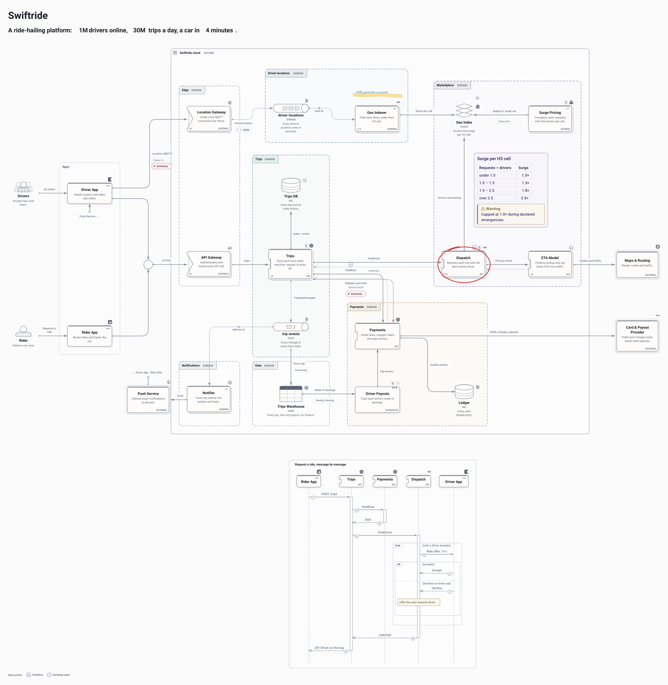
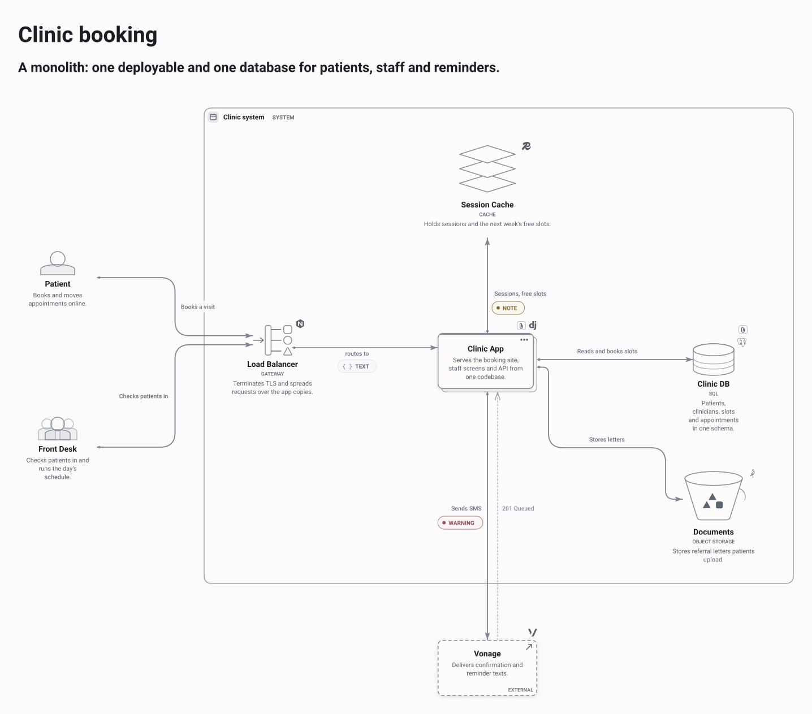
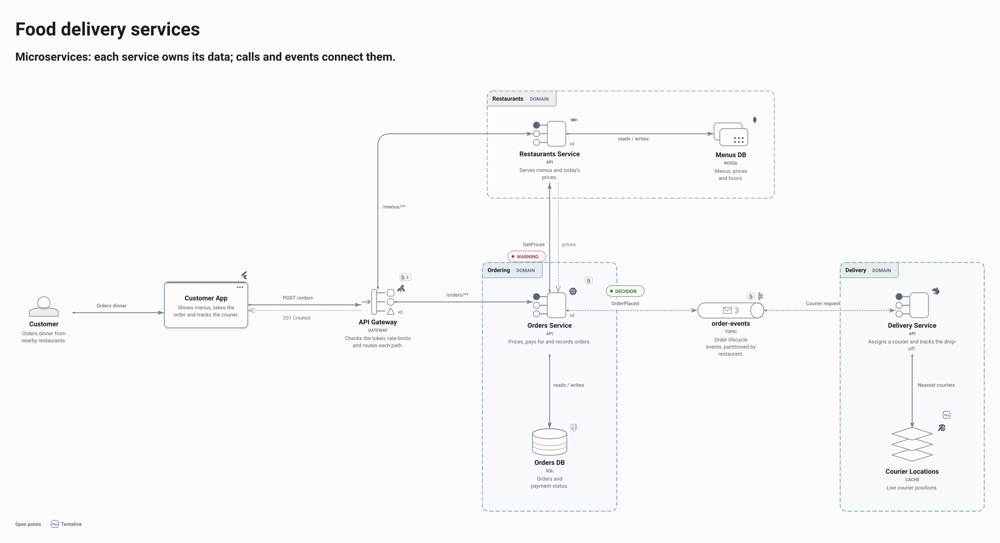
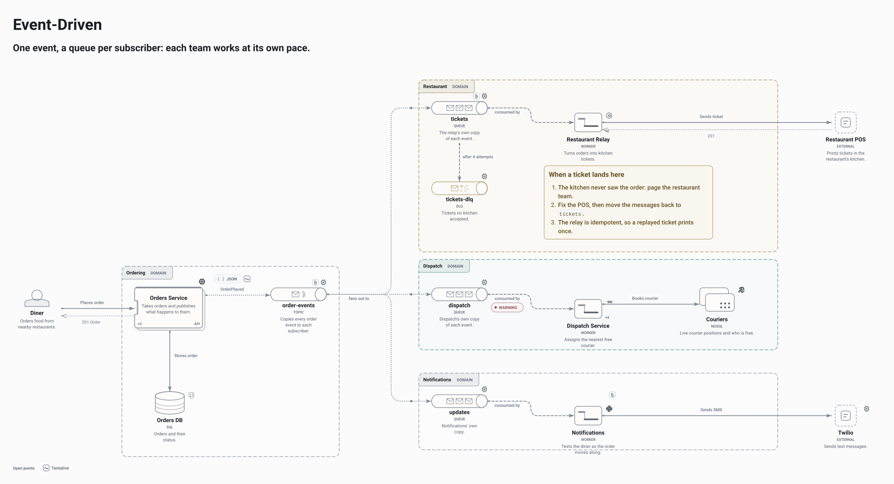
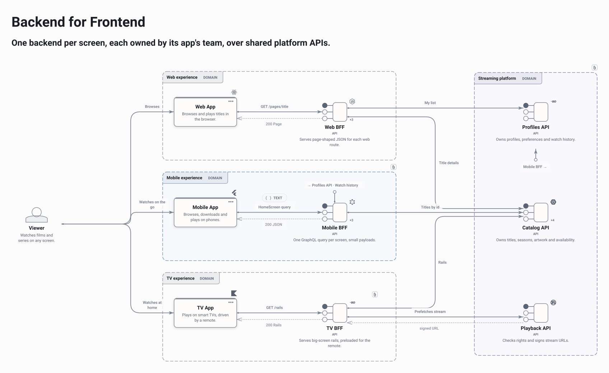
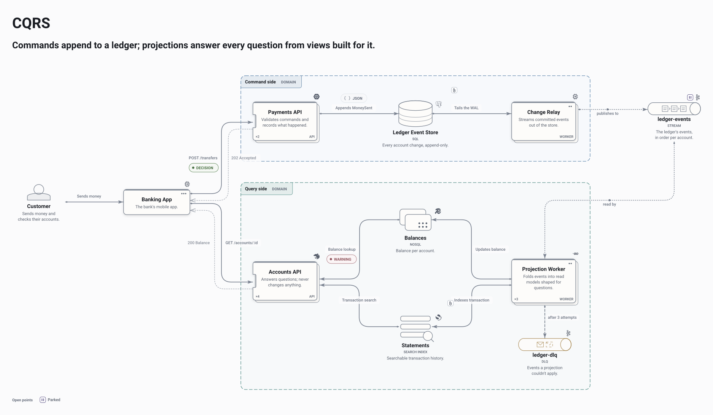
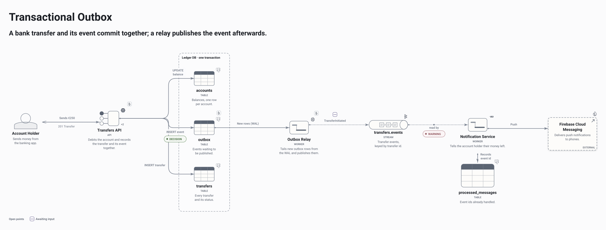

# Draft Canvas starters

Ready-made architecture diagrams for [Draft Canvas](https://github.com/acltabontabon/draft-canvas).
Each starter is an ordinary `.draftcanvas` file: open it, change anything, and it's yours.

Every starter is a worked example in a realistic, fictional system: named services with their
technologies, a main flow and its failure path to present, notes on the decisions and risks, and a
drill-down view where the internals are the point. Rename the parts and keep the shape.

Four whole systems show everything Draft Canvas can draw on one canvas: a
[video streaming platform](starters/examples/video-streaming/), a
[music streaming service](starters/examples/music-streaming/), a
[ride-hailing platform](starters/examples/ride-hailing/) and a
[food delivery marketplace](starters/examples/food-delivery/). Each has nested boundaries, a
junction, styled text, sketch ink, portals, a native sequence diagram, drill-down views, and a flow
for each journey through it.

Draft Canvas lists these under **Starters**, but only after you choose to load them. Loading
reads this repository from GitHub; nothing about your own diagrams is sent. When a starter here
changes, the app marks it **Updated** the next time you refresh. Diagrams you already made from
it stay as they are.

## Gallery

<!-- gallery:start -->

### Whole systems and examples

<table>
<tr>
<td width="100%" valign="top">
<a href="starters/examples/video-streaming/">
<picture>
  <source media="(prefers-color-scheme: dark)" srcset="starters/examples/video-streaming/preview-dark.svg">
  
</picture>
</a>
<p><a href="starters/examples/video-streaming/"><b>Video streaming platform</b></a><br>
<sub>A whole streaming service: devices, edge, playback, discovery, data and an ISP-hosted video edge</sub></p>
</td>
</tr>
<tr>
<td width="100%" valign="top">
<a href="starters/examples/music-streaming/">
<picture>
  <source media="(prefers-color-scheme: dark)" srcset="starters/examples/music-streaming/preview-dark.svg">
  
</picture>
</a>
<p><a href="starters/examples/music-streaming/"><b>Music streaming service</b></a><br>
<sub>A whole music service: playback from a CDN, an AI DJ, weekly mixes, royalties and artist releases</sub></p>
</td>
</tr>
<tr>
<td width="100%" valign="top">
<a href="starters/examples/ride-hailing/">
<picture>
  <source media="(prefers-color-scheme: dark)" srcset="starters/examples/ride-hailing/preview-dark.svg">
  
</picture>
</a>
<p><a href="starters/examples/ride-hailing/"><b>Ride-hailing platform</b></a><br>
<sub>A whole two-sided marketplace: live driver locations, dispatch, surge, trips, payments and payouts</sub></p>
</td>
</tr>
<tr>
<td width="100%" valign="top">
<a href="starters/examples/food-delivery/">
<picture>
  <source media="(prefers-color-scheme: dark)" srcset="starters/examples/food-delivery/preview-dark.svg">
  
</picture>
</a>
<p><a href="starters/examples/food-delivery/"><b>Food delivery marketplace</b></a><br>
<sub>A three-sided marketplace: customers, restaurants and couriers, an order saga with refunds, dispatch and payouts</sub></p>
</td>
</tr>
<tr>
<td width="100%" valign="top">
<a href="starters/examples/order-processing/">
<picture>
  <source media="(prefers-color-scheme: dark)" srcset="starters/examples/order-processing/preview-dark.svg">
  
</picture>
</a>
<p><a href="starters/examples/order-processing/"><b>Order processing</b></a><br>
<sub>A shop takes the payment, queues fulfilment, and parks orders the warehouse keeps refusing</sub></p>
</td>
</tr>
</table>

### Architectures

<table>
<tr>
<td width="50%" valign="top">
<a href="starters/architectures/monolith/">
<picture>
  <source media="(prefers-color-scheme: dark)" srcset="starters/architectures/monolith/preview-dark.svg">
  
</picture>
</a>
<p><a href="starters/architectures/monolith/"><b>Monolith</b></a><br>
<sub>A clinic's booking site, staff screens and API in one Django app, deployed as one unit behind NGINX</sub></p>
</td>
<td width="50%" valign="top">
<a href="starters/architectures/modular-monolith/">
<picture>
  <source media="(prefers-color-scheme: dark)" srcset="starters/architectures/modular-monolith/preview-dark.svg">
  
</picture>
</a>
<p><a href="starters/architectures/modular-monolith/"><b>Modular Monolith</b></a><br>
<sub>A course platform as one Spring Boot deployable with Catalog, Enrollment, Billing and Notifications modules</sub></p>
</td>
</tr>
<tr>
<td width="50%" valign="top">
<a href="starters/architectures/microservices/">
<picture>
  <source media="(prefers-color-scheme: dark)" srcset="starters/architectures/microservices/preview-dark.svg">
  
</picture>
</a>
<p><a href="starters/architectures/microservices/"><b>Microservices</b></a><br>
<sub>A food-delivery platform: services behind Kong, each owning its data, talking by gRPC and Kafka events</sub></p>
</td>
<td width="50%" valign="top">
<a href="starters/architectures/event-driven/">
<picture>
  <source media="(prefers-color-scheme: dark)" srcset="starters/architectures/event-driven/preview-dark.svg">
  
</picture>
</a>
<p><a href="starters/architectures/event-driven/"><b>Event-Driven</b></a><br>
<sub>One event, many reactions: a topic fans out to a queue per subscriber, with a dead-letter queue for failures</sub></p>
</td>
</tr>
<tr>
<td width="50%" valign="top">
<a href="starters/architectures/hexagonal/">
<picture>
  <source media="(prefers-color-scheme: dark)" srcset="starters/architectures/hexagonal/preview-dark.svg">
  
</picture>
</a>
<p><a href="starters/architectures/hexagonal/"><b>Hexagonal</b></a><br>
<sub>A bank's transfers core owns its ports; REST, a job, JPA, Kafka and a fraud vendor plug in as adapters</sub></p>
</td>
<td width="50%" valign="top">
<a href="starters/architectures/bff/">
<picture>
  <source media="(prefers-color-scheme: dark)" srcset="starters/architectures/bff/preview-dark.svg">
  
</picture>
</a>
<p><a href="starters/architectures/bff/"><b>Backend for Frontend</b></a><br>
<sub>Web, mobile and TV each get a backend shaped for their screens, over shared platform APIs</sub></p>
</td>
</tr>
<tr>
<td width="50%" valign="top">
<a href="starters/architectures/cqrs/">
<picture>
  <source media="(prefers-color-scheme: dark)" srcset="starters/architectures/cqrs/preview-dark.svg">
  
</picture>
</a>
<p><a href="starters/architectures/cqrs/"><b>CQRS</b></a><br>
<sub>A bank's payments write events on one side; projections build balances and searchable history on the other</sub></p>
</td>
<td width="50%"></td>
</tr>
</table>

### Data architectures

<table>
<tr>
<td width="50%" valign="top">
<a href="starters/data/medallion/">
<picture>
  <source media="(prefers-color-scheme: dark)" srcset="starters/data/medallion/preview-dark.svg">
  
</picture>
</a>
<p><a href="starters/data/medallion/"><b>Medallion</b></a><br>
<sub>A ride-hailing lakehouse refines raw trips into Bronze, Silver and Gold, and quarantines bad rows</sub></p>
</td>
<td width="50%" valign="top">
<a href="starters/data/kappa/">
<picture>
  <source media="(prefers-color-scheme: dark)" srcset="starters/data/kappa/preview-dark.svg">
  
</picture>
</a>
<p><a href="starters/data/kappa/"><b>Kappa</b></a><br>
<sub>Card fraud scoring from one durable log: live scoring, and a full replay to rebuild with new rules</sub></p>
</td>
</tr>
<tr>
<td width="50%" valign="top">
<a href="starters/data/cdc/">
<picture>
  <source media="(prefers-color-scheme: dark)" srcset="starters/data/cdc/preview-dark.svg">
  
</picture>
</a>
<p><a href="starters/data/cdc/"><b>Change Data Capture</b></a><br>
<sub>A marketplace streams committed listing changes from PostgreSQL to search, cache and warehouse</sub></p>
</td>
<td width="50%"></td>
</tr>
</table>

### Patterns

<table>
<tr>
<td width="50%" valign="top">
<a href="starters/patterns/saga-orchestration/">
<picture>
  <source media="(prefers-color-scheme: dark)" srcset="starters/patterns/saga-orchestration/preview-dark.svg">
  
</picture>
</a>
<p><a href="starters/patterns/saga-orchestration/"><b>Saga – Orchestration</b></a><br>
<sub>One orchestrator books a trip step by step, and cancels the done steps in reverse when the card is declined</sub></p>
</td>
<td width="50%" valign="top">
<a href="starters/patterns/saga-choreography/">
<picture>
  <source media="(prefers-color-scheme: dark)" srcset="starters/patterns/saga-choreography/preview-dark.svg">
  
</picture>
</a>
<p><a href="starters/patterns/saga-choreography/"><b>Saga – Choreography</b></a><br>
<sub>A food order moves through payment and kitchen by events alone, and unwinds by events when a restaurant says no</sub></p>
</td>
</tr>
<tr>
<td width="50%" valign="top">
<a href="starters/patterns/transactional-outbox/">
<picture>
  <source media="(prefers-color-scheme: dark)" srcset="starters/patterns/transactional-outbox/preview-dark.svg">
  
</picture>
</a>
<p><a href="starters/patterns/transactional-outbox/"><b>Transactional Outbox</b></a><br>
<sub>A bank transfer and its event commit in one transaction; Debezium publishes it after, and consumers drop duplicates</sub></p>
</td>
<td width="50%"></td>
</tr>
</table>

<!-- gallery:end -->

## Using a starter without the app's gallery

Download any `.draftcanvas` file and open it in Draft Canvas (**Import** on the web, **Open** on
desktop), or drop it on the canvas.

## How this repository is organised

```
catalog.json              generated index the app reads first (do not edit by hand)
catalog.schema.json       its shape
starters/
  architectures/<id>/     how a whole system is organised
  data/<id>/              how data moves and is refined
  patterns/<id>/          one recurring design problem, at its own scope
  examples/<id>/          whole systems and worked examples
    <id>.draftcanvas      the diagram
    spec.json             what tools/build.ts builds the diagram from
    starter.json          name, summary, search words, order
    README.md             what it shows, when to use it, what to watch out for
    preview.svg           light picture, drawn by Draft Canvas
    preview-dark.svg      dark picture
scripts/catalog.mjs       builds catalog.json and the gallery above
tools/                    build, picture and screenshot starters with Draft Canvas itself
```

A folder is one starter, so adding one never touches another. The app finds files only through
`catalog.json`, which records each file's SHA-256: an app that already has a copy downloads a
starter again only when it changed.

## Contributing

See [CONTRIBUTING.md](CONTRIBUTING.md). Starters are licensed under [Apache-2.0](LICENSE), like
Draft Canvas.
