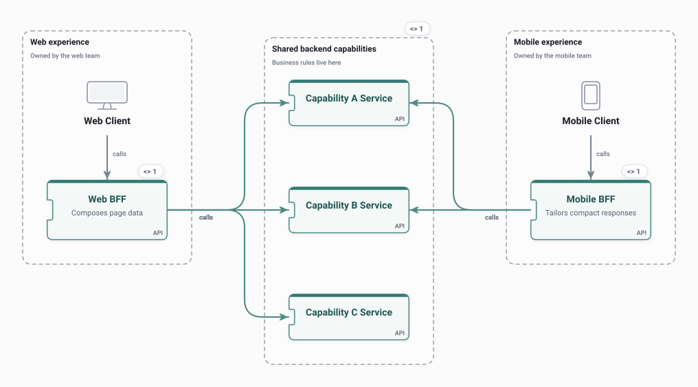

# Backend for Frontend

One backend per frontend, each owned by that client's team, composing calls to shared backend capabilities.

<picture>
  <source media="(prefers-color-scheme: dark)" srcset="preview-dark.svg">
  
</picture>

## Use it when

- Web and mobile need different shapes of the same data.
- Frontend teams want to change their API without coordinating every release.

## Watch out for

- Logic duplicated across BFFs instead of living in the shared services.
- One more service per client to run.

## Flows

Play these in Draft Canvas with **Present**:

- **Web request**
- **Mobile request**

Open [bff.draftcanvas](bff.draftcanvas) in Draft Canvas, or add it from **Starters**.
