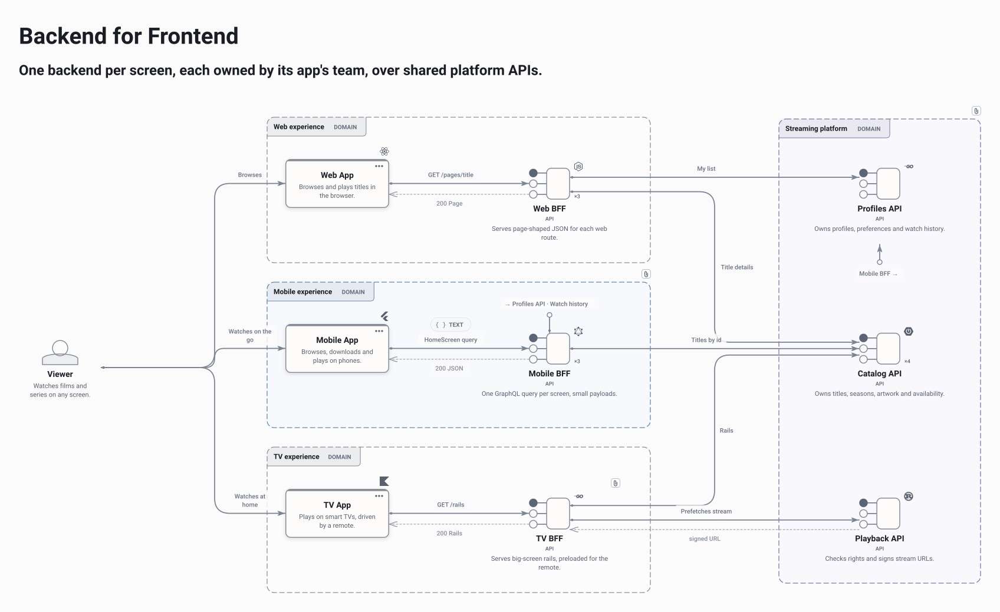

# Backend for Frontend

One backend per frontend, owned by that frontend's team. A streaming service's web, mobile and TV
apps each talk to their own BFF, which composes the shared platform APIs into exactly what its
screens need: page-shaped JSON for the web, one GraphQL query per screen for phones, preloaded rails
for TVs.

<picture>
  <source media="(prefers-color-scheme: dark)" srcset="preview-dark.svg">
  
</picture>

## The example

A **Viewer** watches on three screens, each with its own experience team:

- **Web App** (React) → **Web BFF** (Node.js), which builds a whole title page in one request.
- **Mobile App** (Flutter) → **Mobile BFF** (GraphQL), one query per screen, artwork cut to phone
  sizes.
- **TV App** (Kotlin) → **TV BFF** (Go), which prefetches a signed stream for the focused title.

The **Streaming platform** owns the business rules: **Catalog API** (Spring Boot), **Profiles API**
(Go) and **Playback API** (Rust).

## Use it when

- Web, mobile and TV need different shapes and sizes of the same data.
- Frontend teams want to change their API without coordinating every release.
- A screen should load in one round trip instead of many calls from a slow network.

## Watch out for

- Business rules creeping into BFFs and drifting apart; keep them in the platform APIs.
- One more service per client to build, run and keep secure.
- A BFF that waits on every call is as slow as its slowest one; set budgets and degrade.

## Flows

Play these in Draft Canvas with **Present**:

- **Open the app's home screen** — one GraphQL query, composed from Profiles and Catalog.
- **Profiles is slow** (alternative path, `Shift+F` while presenting) — the BFF stops waiting and
  ships the screen without "Continue watching".
- **Open a title page on the web** — the Web BFF's page-shaped response.
- **Start watching on TV** — rails, then a prefetched stream so play is instant.
- **Home screen, inside the Mobile BFF** — schema, resolver, batch loader and clients one level down.

## Look closer

- Step into **Mobile BFF** to see why one query stays cheap: a batch loader collapses repeated calls.
- The Mobile BFF's call for watch history is drawn as a **portal** — a labelled stub at each end
  ("→ Profiles API") instead of a line across the diagram. Click a stub's words to jump to the other
  end; **Draw as line** brings the line back.
- Notes record who owns each BFF, warn about duplicated rules, show the `HomeScreen` query and the
  per-call timeouts, and ask whether TV really needs a BFF of its own.

Open [bff.draftcanvas](bff.draftcanvas) in Draft Canvas, or add it from **Starters**.
