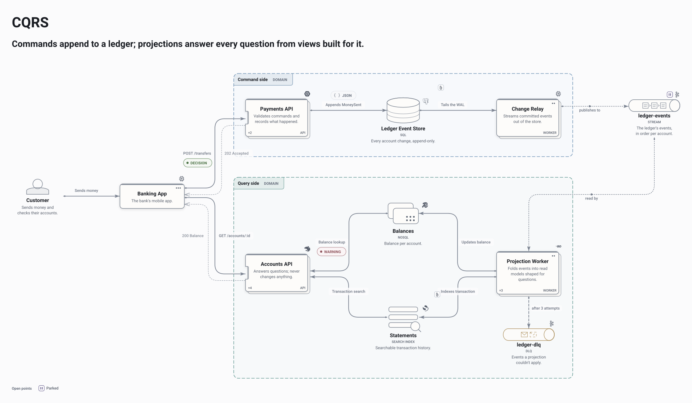

# CQRS

Separate paths for changing state and for asking about it. A bank's Payments API validates commands
and appends events to a ledger; those events stream to the query side, where projections keep read
models shaped for each question: a balance per account, and a searchable statement.

<picture>
  <source media="(prefers-color-scheme: dark)" srcset="preview-dark.svg">
  
</picture>

## The example

On the **Command side**, a **Customer** sends money from the **Banking App** (React Native). The
**Payments API** (Spring Boot) answers `202 Accepted` and appends `MoneySent` to the **Ledger Event
Store** (PostgreSQL). A **Change Relay** (Debezium) tails the write-ahead log and publishes each
committed event to **ledger-events** (Kafka).

On the **Query side**, three **Projection Worker**s (Go) fold events into **Balances** (Redis) and
**Statements** (OpenSearch), which the **Accounts API** (NestJS) reads. An event a projection can't
apply goes to **ledger-dlq** after three tries.

## Use it when

- Reads and writes have very different shapes or loads.
- Several read models (a balance, a search index) answer from one source of truth.
- Explaining eventual consistency between the two sides.

## Watch out for

- Reads lag behind writes; the UI must cope with its own change not showing yet.
- Two models to keep in step as the domain changes, and projections to rebuild.
- An event a projection can't apply leaves that read model stale until someone acts.

## Flows

Play these in Draft Canvas with **Present**:

- **Send money** — the command, the event, and both projections catching up.
- **A projection can't apply an event** (failure path, `Shift+F` while presenting) — the event is
  parked and the read model goes stale.
- **Check the balance** — a key lookup and a search; nothing is computed on read.
- **Read before the projection catches up** (alternative path) — the moment the two sides disagree.
- **Send money, inside the Payments API** — controller, handler, aggregate and event store one
  level down.

## Look closer

- Step into **Payments API** to see the write model: the Account aggregate decides events from the
  account's replayed history.
- The two sides are two bands: commands along the top, questions along the bottom, and
  `ledger-events` the only bridge between them.
- Notes record why commands answer `202`, warn about read lag, ask how Statements gets rebuilt, and
  show the `MoneySent` event and the event table whose primary key stops two writers taking the same
  version.
- A parked open point asks how long `ledger-events` keeps its history.

Open [cqrs.draftcanvas](cqrs.draftcanvas) in Draft Canvas, or add it from **Starters**.
