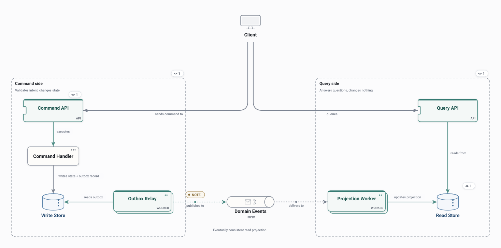

# CQRS

Separate command and query paths: commands change the write store and record events through an outbox; a projection worker builds the read store that queries answer from.

<picture>
  <source media="(prefers-color-scheme: dark)" srcset="preview-dark.svg">
  
</picture>

## Use it when

- Reads and writes have very different shapes or loads.
- Explaining eventual consistency between the two sides.

## Watch out for

- Reads lag behind writes.
- Two models to keep in step as the domain changes.

## Flows

Play these in Draft Canvas with **Present**:

- **Submit command**
- **Read projection**

Open [cqrs.draftcanvas](cqrs.draftcanvas) in Draft Canvas, or add it from **Starters**.
