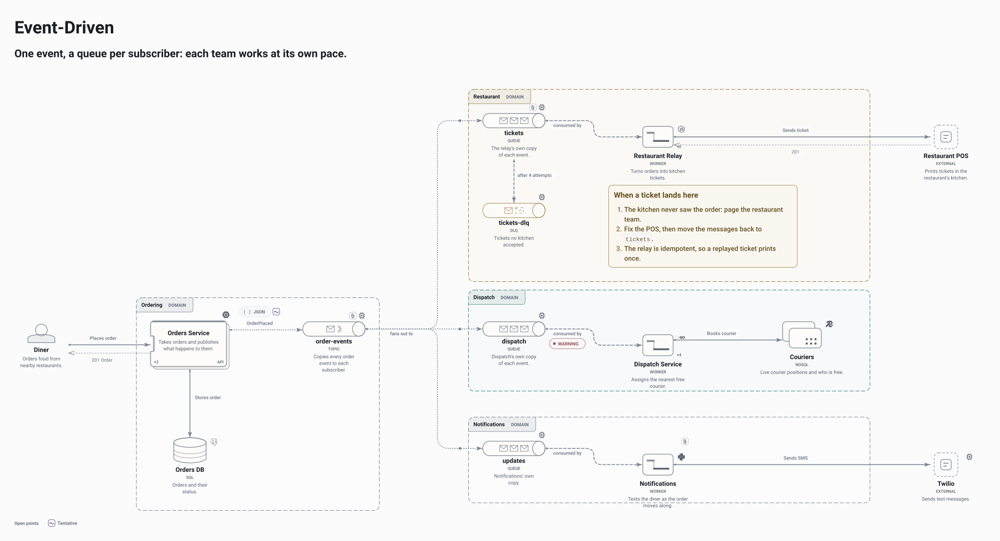

# Event-Driven

One event, many independent reactions. A food-delivery platform's Orders Service publishes
`OrderPlaced` once; a topic copies it into a queue per subscriber, so the restaurant, the couriers
and the diner's texts each move at their own pace, and a failing restaurant never delays a courier.

<picture>
  <source media="(prefers-color-scheme: dark)" srcset="preview-dark.svg">
  
</picture>

## The example

A **Diner** places an order with the **Orders Service** (Spring Boot, three instances), which stores
it in **Orders DB** (PostgreSQL) and publishes `OrderPlaced` to the **order-events** topic (SNS). The
topic fans out to three SQS queues, one per subscriber:

- **tickets** → **Restaurant Relay** (Node.js) → the **Restaurant POS**, which prints a kitchen ticket.
- **dispatch** → **Dispatch Service** (Go, four instances) → books the nearest free courier in
  **Couriers** (Redis).
- **updates** → **Notifications** (Python) → texts the diner through **Twilio**.

A ticket the POS keeps refusing moves to **tickets-dlq** after four attempts.

## Use it when

- Several consumers react to the same change without the producer knowing them.
- One slow or failing consumer must not hold up the others.
- Showing retries, idempotent consumers and where failed messages go.

## Watch out for

- Delivery is at least once: every consumer must handle duplicates.
- Events can arrive out of order across queues; don't let consumers assume an order.
- One request is harder to follow end to end; keep event ids in your logs and traces.
- An event's shape is a contract with consumers you may not know about. Version it.

## Flows

Play these in Draft Canvas with **Present**:

- **An order is placed** — one event, followed down each of its three subscribers in turn.
- **Restaurant POS is offline** (failure path, `Shift+F` while presenting) — retries, then the
  dead-letter queue, while couriers and texts carry on.
- **Dispatch a courier, inside the service** — the queue listener, idempotency guard and courier
  lookup one level down.

## Look closer

- Step into **Dispatch Service** to see how a consumer stays idempotent: every event passes a guard
  before anything changes.
- Notes explain why each subscriber gets its own queue, warn about duplicate delivery, ask whether
  texts must arrive in order, and show the `OrderPlaced` payload and the queue's redrive policy.
- A tentative open point records why `OrderPlaced` carries the pickup location.

Open [event-driven.draftcanvas](event-driven.draftcanvas) in Draft Canvas, or add it from **Starters**.
