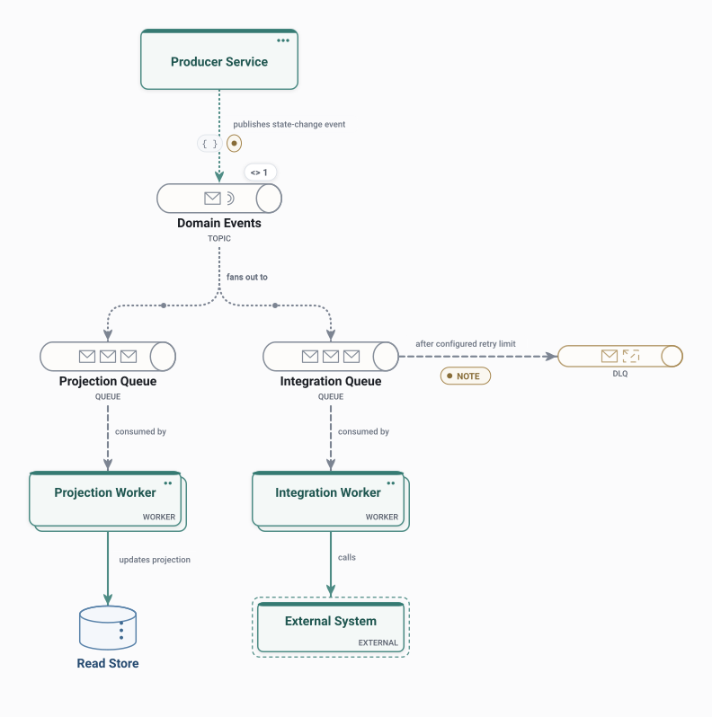

# Event-Driven

A producer publishes events to a topic that fans out to one queue per subscriber; workers consume them, and failed deliveries land in a dead-letter queue.

<picture>
  <source media="(prefers-color-scheme: dark)" srcset="preview-dark.svg">
  
</picture>

## Use it when

- Several consumers react to the same change without the producer knowing them.
- Showing retries and where failed messages go.

## Watch out for

- Delivery is at least once: consumers must handle duplicates.
- The flow of one request is harder to follow end to end.

## Flows

Play these in Draft Canvas with **Present**:

- **Update a projection**
- **Reach an external system**
- **Handle a failed delivery**

Open [event-driven.draftcanvas](event-driven.draftcanvas) in Draft Canvas, or add it from **Starters**.
