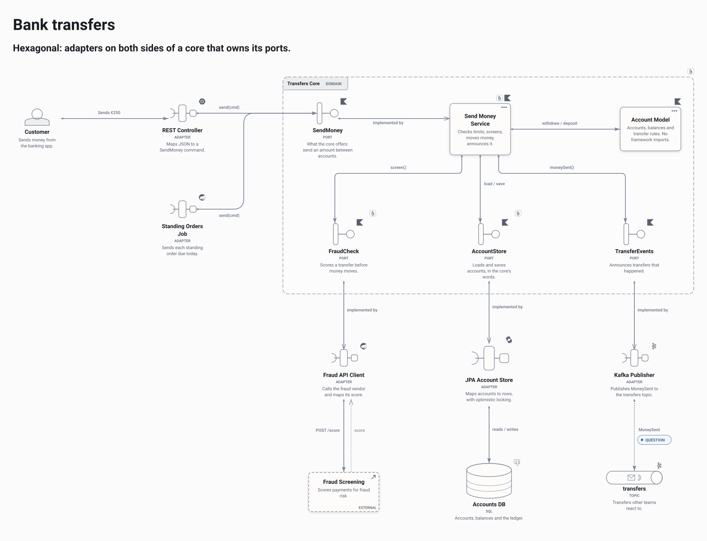

# Hexagonal

An application core that owns its ports, with adapters for HTTP, a scheduled job, persistence,
messaging and a fraud vendor around it. Dependencies point inward: the core imports no framework.

<picture>
  <source media="(prefers-color-scheme: dark)" srcset="preview-dark.svg">
  
</picture>

## The example

A bank's **Transfers Core** offers one inbound port, **SendMoney**, implemented by the **Send Money
Service**, which uses the **Account Model** and three outbound ports it defines itself:
**AccountStore**, **FraudCheck** and **TransferEvents**. Outside, a **REST Controller** and a
**Standing Orders Job** drive the same port; a **JPA Account Store** (PostgreSQL), a **Fraud API
Client** and a **Kafka Publisher** sit behind the outbound ones.

## Use it when

- Keeping business rules independent of frameworks, databases and vendors.
- Testing the core with in-memory adapters, without infrastructure.
- The same use case is driven from several places: HTTP, a job, a message.

## Watch out for

- More indirection than a small service may need.
- Ports drift into thin wrappers if they mirror one adapter or one vendor's API.
- Arrows here read at runtime (port, then the adapter behind it); source dependencies point the other way, inward.

## Flows

Play these in Draft Canvas with **Present**:

- **Send money over HTTP** — from the controller through the port, the fraud check, the model and both stores.
- **Fraud check rejects** (failure path, `Shift+F` while presenting) — the vendor's score becomes the core's own verdict.
- **Run standing orders** — a different driving adapter, the same port and use case.
- **Withdraw, inside the model** — the Account aggregate, its policy, Money and the MoneySent event.

## Look closer

- Connectors read at runtime: a port, then the adapter that implements it (**implemented by**). The source dependency points the other way, inward.
- Driving adapters call in from the left; the use case fans out to its three outbound ports below
  it, each with its adapter and infrastructure straight underneath.
- The **Transfers Core** boundary is **held in place**: Arrange and Tidy up lay the adapters out around it and leave the core where it is.
- Step into **Account Model** for the aggregate and value objects behind `withdraw`.
- Code notes show the `AccountStore` port and a use case wired with in-memory adapters for a test; a warning covers ports that mirror a vendor, and a question asks about an outbox for `MoneySent`.

Open [hexagonal.draftcanvas](hexagonal.draftcanvas) in Draft Canvas, or add it from **Starters**.
