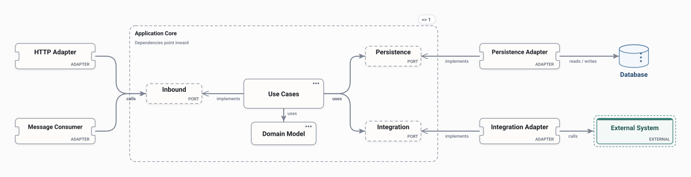

# Hexagonal

An application core that owns its ports, with adapters for HTTP, messages, persistence and external systems around it. Dependencies point inward.

<picture>
  <source media="(prefers-color-scheme: dark)" srcset="preview-dark.svg">
  
</picture>

## Use it when

- Keeping business rules independent of frameworks, databases and transports.
- Testing the core without infrastructure.

## Watch out for

- More indirection than a small service may need.
- Ports drift into thin wrappers if they mirror one adapter.

## Flows

Play these in Draft Canvas with **Present**:

- **Handle an HTTP request**
- **Consume a message**

Open [hexagonal.draftcanvas](hexagonal.draftcanvas) in Draft Canvas, or add it from **Starters**.
