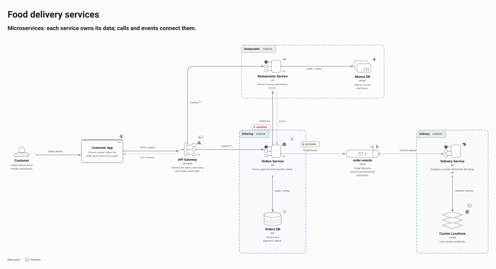

# Microservices

Independently deployed services behind an API gateway, each owning its own data. A food-delivery
platform splits Ordering, Restaurants and Delivery into services that share APIs and events, never
tables.

<picture>
  <source media="(prefers-color-scheme: dark)" srcset="preview-dark.svg">
  
</picture>

## The example

A **Customer** orders in the **Customer App** (Flutter). **Kong** checks the token and routes
`/orders` to the **Orders Service** (Spring Boot, three instances) and `/menus` to the
**Restaurants Service** (Go). Orders gets prices from Restaurants over gRPC, stores the order in
**Orders DB** (PostgreSQL) and publishes `OrderPlaced` to **order-events** (Kafka). The **Delivery
Service** (NestJS) reacts to it and finds the nearest courier in **Courier Locations** (Redis).

## Use it when

- Teams need to deploy and scale parts of the system independently.
- Mapping which service owns which data, and how the others reach it.
- Deciding which calls must be synchronous and which can be events.

## Watch out for

- Calls between services fail and are slow in ways in-process calls are not; guard them.
- Every synchronous call chains availability: one service down can stop the main path.
- Queries that span services need their own design: a read model, an API composer or a BFF.

## Flows

Play these in Draft Canvas with **Present**:

- **Order dinner** — gateway, a synchronous price check, the order's own database, then an event.
- **Restaurants is down** (failure path, `Shift+F` while presenting) — the circuit breaker opens and Orders fails fast.
- **Browse a menu** — the gateway routes straight to Restaurants, which answers from its own store.
- **Place an order, inside Orders** — the request through the controller, use case and adapters, including the Adyen payment.

## Look closer

- Step into **Orders Service** for its components: the controller, the Place Order use case, and adapters for Restaurants (with the breaker), Adyen, PostgreSQL and Kafka.
- Notes cover sharing events rather than tables, the availability cost of the gRPC call, the Resilience4j and Kong settings, the `OrderPlaced` payload, and whether the tracking screen belongs in a BFF.
- An open point records the assumption that courier positions may be lost on a Redis restart.

Open [microservices.draftcanvas](microservices.draftcanvas) in Draft Canvas, or add it from **Starters**.
