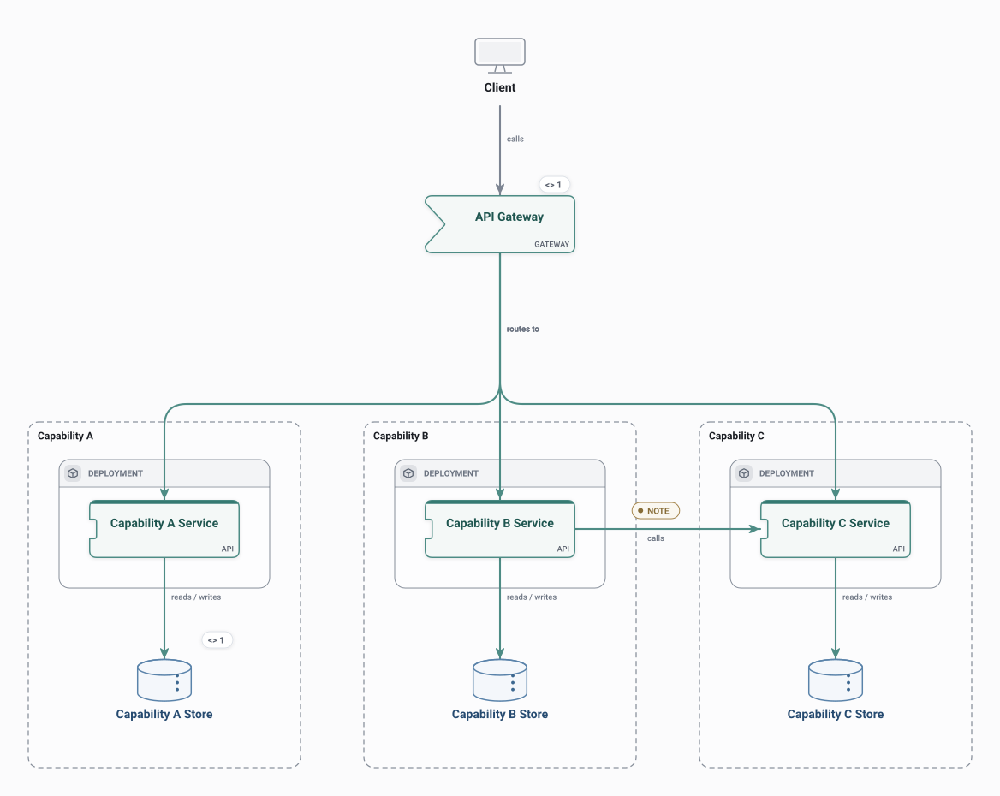

# Microservices

Independently deployed services behind an API gateway, each owning its own data store.

<picture>
  <source media="(prefers-color-scheme: dark)" srcset="preview-dark.svg">
  
</picture>

## Use it when

- Teams need to deploy and scale parts of the system independently.
- Mapping which service owns which data.

## Watch out for

- Calls between services fail and are slow in ways in-process calls are not.
- Queries that span services need their own design.

## Flows

Play these in Draft Canvas with **Present**:

- **Handle a request**
- **Call another service**

Open [microservices.draftcanvas](microservices.draftcanvas) in Draft Canvas, or add it from **Starters**.
