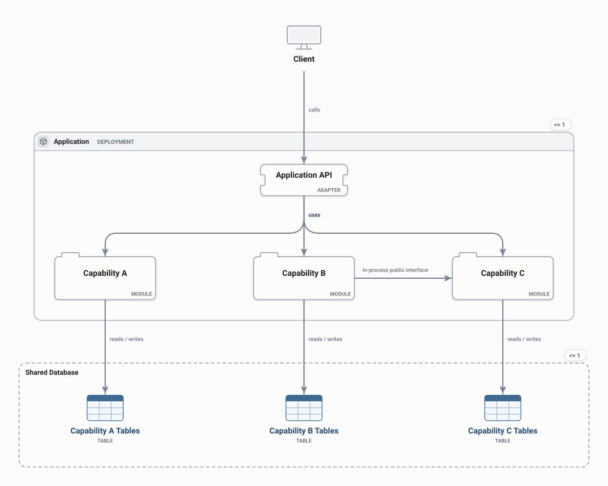

# Modular Monolith

One deployable with explicitly separated modules, each owning its own tables in a shared database and talking to the others through public interfaces.

<picture>
  <source media="(prefers-color-scheme: dark)" srcset="preview-dark.svg">
  
</picture>

## Use it when

- You want clear ownership without the cost of distributed services.
- Preparing a monolith to split later, one module at a time.

## Watch out for

- Module boundaries only hold if calls go through the public interface.
- A shared database makes it easy to reach into another module's tables.

## Flows

Play these in Draft Canvas with **Present**:

- **Handle a request**
- **Collaborate across modules**

Open [modular-monolith.draftcanvas](modular-monolith.draftcanvas) in Draft Canvas, or add it from **Starters**.
