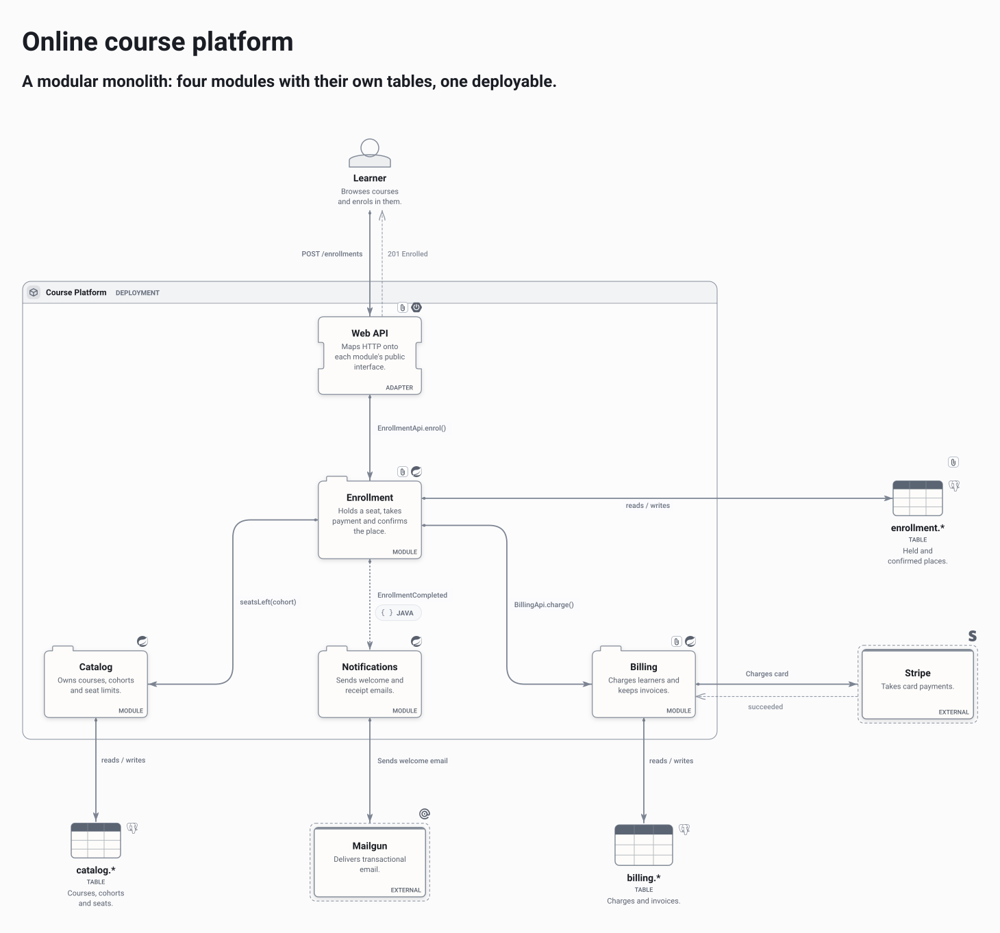

# Modular Monolith

One deployable with explicitly separated modules. A course platform runs as one Spring Boot
application, but Catalog, Enrollment, Billing and Notifications each own their tables and talk to
each other only through public interfaces and in-process events.

<picture>
  <source media="(prefers-color-scheme: dark)" srcset="preview-dark.svg">
  
</picture>

## The example

A **Learner** enrols through the **Web API**, which calls only **Enrollment**'s public interface.
Enrollment asks **Catalog** for seats left, holds a seat in `enrollment.*`, and asks **Billing** to
charge the card with **Stripe**. Once committed, an `EnrollmentCompleted` event reaches
**Notifications**, which sends the welcome email through **Mailgun**. Each module's tables sit in
its own schema on one PostgreSQL server.

## Use it when

- You want clear ownership without the cost of distributed services.
- Preparing a monolith to split later, one module at a time.
- Several teams share one codebase and need lines they cannot cross by accident.

## Watch out for

- Module boundaries only hold if calls go through the public interface; enforce it in a build test.
- A shared database server makes it easy to join another module's tables; grant each module its own schema.
- In-process events vanish on a crash unless they are stored before they are handled.

## Flows

Play these in Draft Canvas with **Present**:

- **Enrol in a course** — across three modules, each through the next one's interface.
- **Card declined** (failure path, `Shift+F` while presenting) — Billing answers Declined and Enrollment releases the seat.
- **Enrol, inside the module** — the same request inside Enrollment: its port, service, repository and event publisher.

## Look closer

- Step into **Enrollment** to see what a module hides: only `EnrollmentApi` is public; the service, repository and tables are not.
- Code notes show the Spring Modulith test that fails the build on a reach-in, and the event listener in Notifications.
- A warning explains schema-per-module grants; a question asks whether Billing should be the first module to extract.

Open [modular-monolith.draftcanvas](modular-monolith.draftcanvas) in Draft Canvas, or add it from **Starters**.
