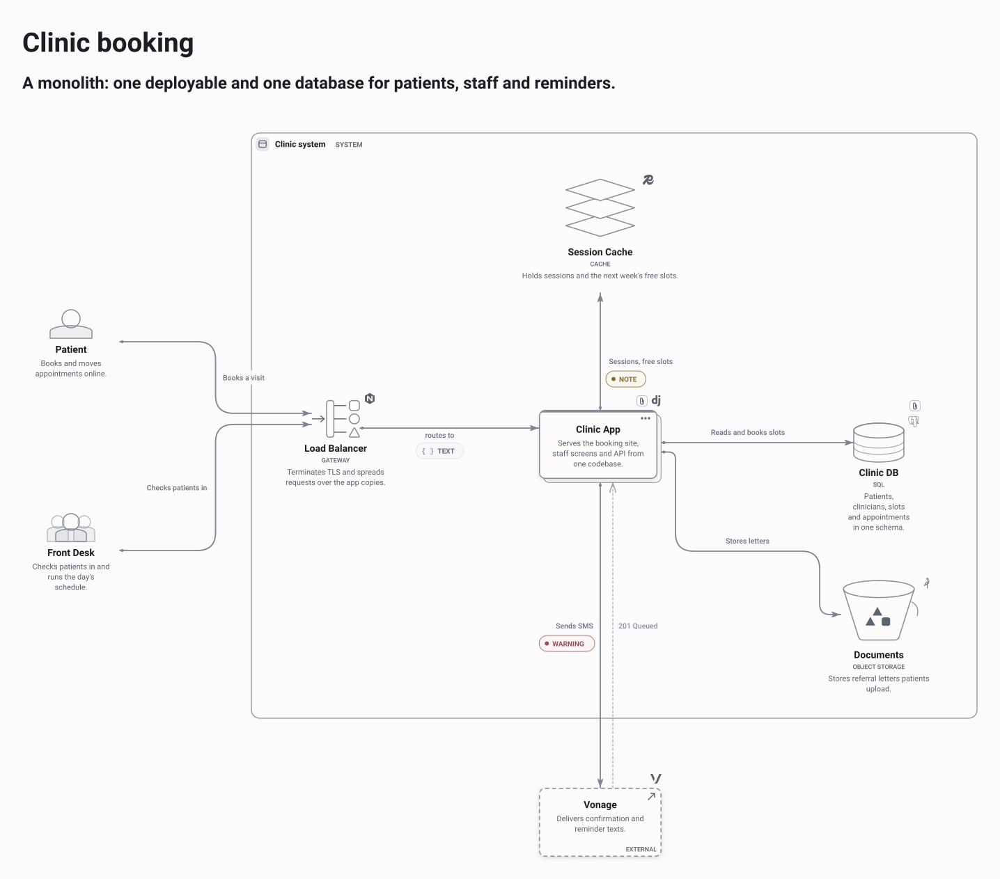

# Monolith

A clinic's whole booking system as one application: the patient booking site, the front-desk
screens and the API are one Django codebase, built and deployed as a unit. It scales by running
identical copies behind a load balancer, over one database.

<picture>
  <source media="(prefers-color-scheme: dark)" srcset="preview-dark.svg">
  
</picture>

## The example

A **Patient** books a visit and the **Front Desk** checks patients in, both through **NGINX**,
which spreads requests over three copies of the **Clinic App** (Django). The app keeps sessions and
the week's free slots in **Session Cache** (Redis), everything else in one **Clinic DB** schema
(PostgreSQL), referral letters in **Documents** (MinIO), and texts confirmations through **Vonage**.

## Use it when

- A new product or a small team, where one deployable keeps change cheap.
- Explaining where a request goes before any of it is split out.
- Scaling by running more identical copies behind a load balancer.

## Watch out for

- Every change ships the whole application, and one bad release takes everything down.
- Slow calls inside a request, like sending a text, slow every user; move them to a job.
- Module lines inside the codebase blur unless they are kept on purpose.

## Flows

Play these in Draft Canvas with **Present**:

- **Book an appointment** — from the booking site through one transaction to the confirmation text.
- **Vonage is down** (alternative path, `Shift+F` while presenting) — the text fails, the booking stands.
- **Check a patient in** — the same app and schema serving the staff screens.
- **Book an appointment, inside the app** — the request through views and the Scheduling, Patients and Notifications modules.

## Look closer

- Step into **Clinic App** to see its parts: the booking views and the Scheduling, Patients and Notifications modules, one function call apart.
- Notes record the one-deploy decision, why sessions live in Redis, the NGINX upstream, a warning about texting inside the request, and a question about who would own which tables.

Open [monolith.draftcanvas](monolith.draftcanvas) in Draft Canvas, or add it from **Starters**.
