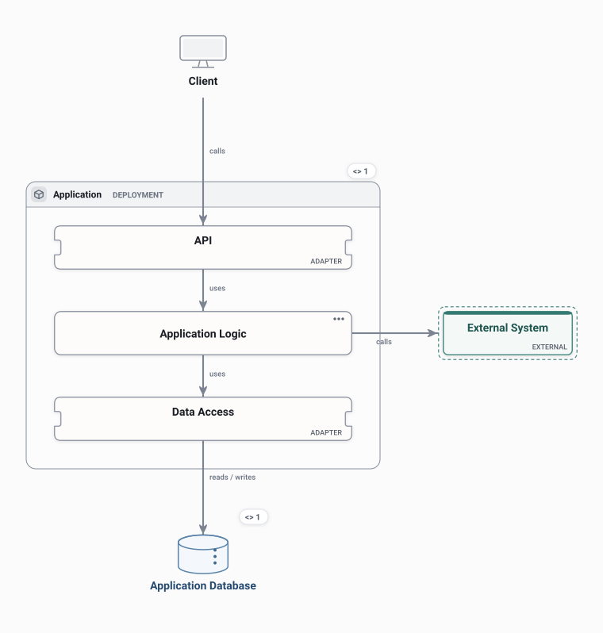

# Monolith

One application built and deployed as a unit: an API layer, the application logic and data access, over one database.

<picture>
  <source media="(prefers-color-scheme: dark)" srcset="preview-dark.svg">
  
</picture>

## Use it when

- A new product or a small team, where one deployable keeps change cheap.
- Explaining where a request goes before any of it is split out.

## Watch out for

- Every change ships the whole application.
- Layers blur over time unless their boundaries are kept on purpose.

## Flows

Play these in Draft Canvas with **Present**:

- **Handle a request**
- **Call an external dependency**

Open [monolith.draftcanvas](monolith.draftcanvas) in Draft Canvas, or add it from **Starters**.
