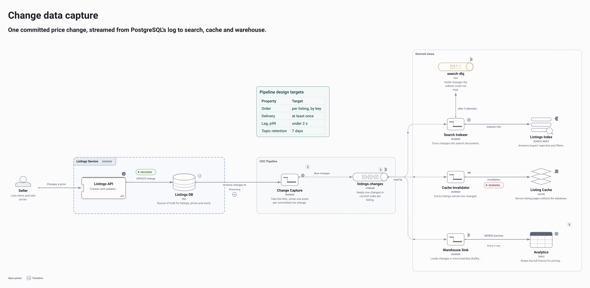

# Change Data Capture

The application writes only to its own database. A connector reads every committed change from the
database's log once and publishes it to a stream, and each derived view (search, cache, warehouse)
consumes that stream at its own pace. Nothing is written twice, and nothing is lost if a consumer
is down for a while.

<picture>
  <source media="(prefers-color-scheme: dark)" srcset="preview-dark.svg">
  
</picture>

## The example

A marketplace's listings. A **Seller** changes a price through the **Listings API** (Spring Boot),
which updates **Listings DB** (PostgreSQL). **Change Capture** (Debezium) tails the write-ahead log
and publishes each row change to **listings.changes** (Kafka). From there, the **Search Indexer**
updates the **Listings Index** (Elasticsearch), the **Cache Invalidator** evicts the page from the
**Listing Cache** (Redis), and the **Warehouse Sink** merges batches into **Analytics** (Snowflake)
every five minutes. Changes the indexer cannot map are parked in **search-dlq** after three tries.

## Use it when

- Keeping search, caches or analytics in sync with a database without dual writes.
- Feeding several derived views, each at its own pace, from one source of truth.
- Backfilling a new view from a snapshot without querying production.

## Watch out for

- Derived views are eventually consistent: they can show the old value for a moment.
- Events mirror the table: a renamed column breaks every consumer.
- If the connector stops for longer than the WAL is kept, it must snapshot again.

## Flows

Play these in Draft Canvas with **Present**:

- **A price change reaches every view**: one write, captured once, read by three consumers.
- **Backfill a new view** (variant, `Shift+F` while presenting): Debezium snapshots existing rows,
  then streams live changes.
- **A change cannot be indexed** (variant): the indexer parks it and keeps going.

## Look closer

- A card above the pipeline lists its design targets: per-listing order, at-least-once
  delivery, lag and topic retention. Replace the numbers with your own.
- The connector carries its Debezium configuration.
- Notes explain why the API never writes twice, and warn about schema changes and stale reads.
- A question asks whether analysts need deletes; an open point records the assumed WAL retention.

Open [cdc.draftcanvas](cdc.draftcanvas) in Draft Canvas, or add it from **Starters**.
