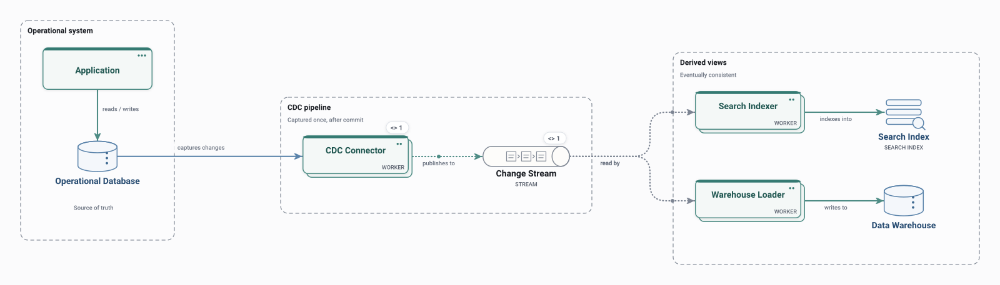

# Change Data Capture

A connector captures committed changes from an operational database once and publishes them to a change stream that keeps derived views, such as a search index and a warehouse, up to date.

<picture>
  <source media="(prefers-color-scheme: dark)" srcset="preview-dark.svg">
  
</picture>

## Use it when

- Keeping other systems in sync with a database without dual writes.
- Feeding search, caches or analytics from the source of truth.

## Watch out for

- Derived views are eventually consistent.
- Schema changes in the source ripple to every consumer.

## Flows

Play these in Draft Canvas with **Present**:

- **Capture and fan out**

Open [cdc.draftcanvas](cdc.draftcanvas) in Draft Canvas, or add it from **Starters**.
