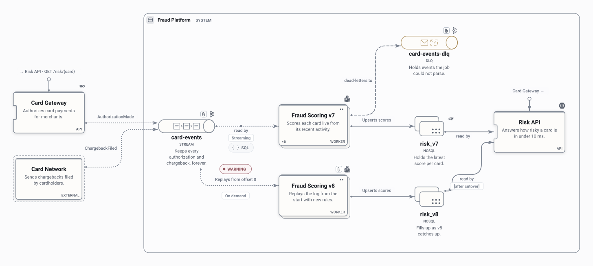

# Kappa

Live and historical data go through one durable log and one kind of stream job. A view is never
patched by a separate batch system: to change how it is computed, a new version of the job replays
the log from the start into a new view, and readers switch once it has caught up.

<picture>
  <source media="(prefers-color-scheme: dark)" srcset="preview-dark.svg">
  
</picture>

## The example

A card issuer scores fraud risk. The **Card Gateway** (Go) and the **Card Network**'s chargeback
feed append to **card-events** (Kafka), kept forever. **Fraud Scoring v7** (Flink, six instances)
reads it live and keeps each card's latest score in **risk_v7** (Cassandra), which the **Risk API**
(Spring Boot) serves in under 10 ms. To ship new rules, **Fraud Scoring v8** replays the log from
offset 0 into **risk_v8**; the Risk API reads it after the cutover. Events the job cannot parse are
parked in **card-events-dlq**.

## Use it when

- Real-time views where reprocessing history must use the same code as live processing.
- Replacing a separate batch layer with one stream processor and a log you can replay.
- Changing scoring rules and rebuilding a view side by side before switching to it.

## Watch out for

- Replaying a long log takes hours and cluster capacity; plan the cutover.
- The log's retention decides how far back you can rebuild.
- Logic that reads the clock instead of event time scores a replay differently from live.

## Flows

Play these in Draft Canvas with **Present**:

- **Score a card payment**: the gateway asks for a score, then the authorization updates it.
- **Rebuild with new rules** (variant, `Shift+F` while presenting): v8 replays history into a new
  view while v7 keeps serving.
- **An event cannot be parsed** (variant): the job parks it and moves on.
- **Score an event, inside the job**: the same event through the Flink job's operators.

## Look closer

- Step into **Fraud Scoring v7** to see the job's operators: source, key by card, velocity windows,
  rules and model, and the Cassandra sink.
- The gateway's call to the Risk API is drawn as a **portal**: a labelled stub at each end instead of
  a line across the whole diagram. Click a stub's words to jump to the other end. (Portals are new in
  file format 29.)
- Notes show the Flink SQL window, explain the infinite retention and event time, and warn about
  the cost of a replay.

Open [kappa.draftcanvas](kappa.draftcanvas) in Draft Canvas, or add it from **Starters**.
