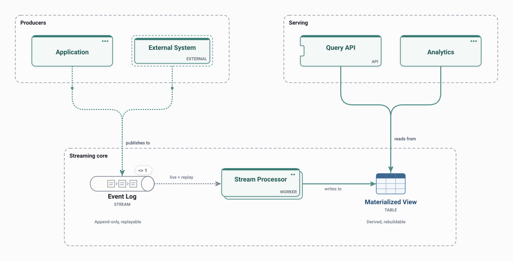

# Kappa

Live and historical data go through one durable event log and one stream processor; views are rebuilt by replaying the log.

<picture>
  <source media="(prefers-color-scheme: dark)" srcset="preview-dark.svg">
  
</picture>

## Use it when

- Real-time views where reprocessing history must use the same code.
- Replacing a separate batch layer.

## Watch out for

- Replays of a long log take time and capacity.
- The log's retention decides how far back you can rebuild.

## Flows

Play these in Draft Canvas with **Present**:

- **Live processing**
- **Rebuild view**

Open [kappa.draftcanvas](kappa.draftcanvas) in Draft Canvas, or add it from **Starters**.
