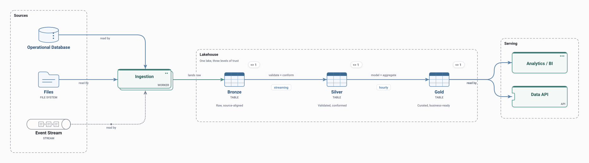

# Medallion

Sources are ingested into a lakehouse and refined in three steps: raw (bronze), validated and conformed (silver), and business-ready (gold), served to analytics and APIs.

<picture>
  <source media="(prefers-color-scheme: dark)" srcset="preview-dark.svg">
  
</picture>

## Use it when

- Building analytics on data from several operational sources.
- Showing where data quality is enforced.

## Watch out for

- Each layer stores another copy of the data.
- Late-arriving or corrected data needs reprocessing through every layer.

## Flows

Play these in Draft Canvas with **Present**:

- **Raw to insight**

Open [medallion.draftcanvas](medallion.draftcanvas) in Draft Canvas, or add it from **Starters**.
