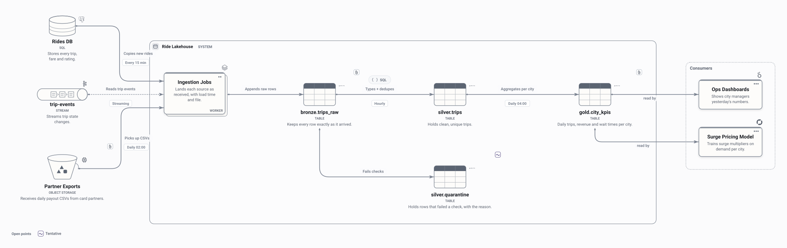

# Medallion

A lakehouse that refines data in three steps of trust: **Bronze** keeps every row exactly as it
arrived, **Silver** holds clean, typed, deduplicated rows, and **Gold** holds the business-ready
numbers people read. Rows that fail a check are quarantined, not silently dropped.

<picture>
  <source media="(prefers-color-scheme: dark)" srcset="preview-dark.svg">
  
</picture>

## The example

A ride-hailing company's analytics. **Ingestion Jobs** (Databricks) copy new rides from **Rides DB**
(PostgreSQL) every 15 minutes, read **trip-events** (Kafka) as they stream, and pick up partners'
payout CSVs from **Partner Exports** (S3) each night. Everything lands untouched in
**bronze.trips_raw**. An hourly job types and deduplicates it into **silver.trips**, sending rows that
fail a check to **silver.quarantine**. A nightly job aggregates **gold.city_kpis**, which **Ops
Dashboards** (Looker) and the **Surge Pricing Model** (MLflow) read. Every table is Delta. Each
connector shows how often it runs.

## Use it when

- Building analytics on data from several operational sources at different cadences.
- Showing where data quality is enforced, and where rows that fail it go.
- You need to rebuild cleaned data after a bug fix without asking the sources again.

## Watch out for

- Each layer stores another copy of the data, and each copy costs storage and compute.
- Late or corrected source data has to be reprocessed through every layer after it.
- A quarantine table nobody triages quietly drops data from every report.

## Flows

Play these in Draft Canvas with **Present**:

- **Raw to insight**: a ride travels from PostgreSQL to a Looker dashboard.
- **A bad row is quarantined** (variant, `Shift+F` while presenting): a negative fare lands in
  Bronze, fails a Silver check and never reaches Gold.

## Look closer

- The Silver connector carries the Delta Live Tables definition, with its expectations.
- Notes explain why Bronze is never cleaned, warn that Gold lags a Silver fix by a night, and ask
  whether partners re-send corrected files.
- An open point records who is assumed to triage the quarantine.
- Hold `Shift` and rest the pointer on a table to light everything it comes from and feeds.

Open [medallion.draftcanvas](medallion.draftcanvas) in Draft Canvas, or add it from **Starters**.
