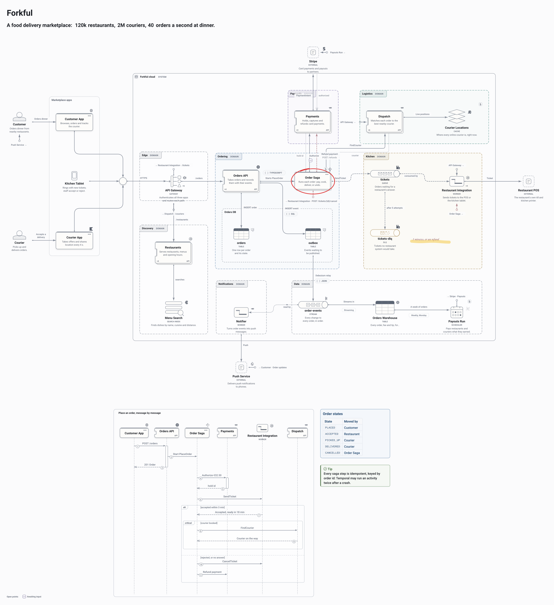

# Food delivery marketplace

A complete, fictional food delivery marketplace, **Forkful**, drawn as one canvas. Three kinds of
people use it: customers who order, restaurants who cook and couriers who deliver. Every order is
a saga. The card is held, the restaurant has three minutes to accept, and a courier is booked
once it does. If anything fails, the saga undoes the earlier steps, newest first. Each change
leaves through an outbox, so the customer is told and everyone is paid.

<picture>
  <source media="(prefers-color-scheme: dark)" srcset="preview-dark.svg">
  
</picture>

## The example

- **Marketplace apps**: the **Customer App** (React Native), the restaurant's **Kitchen Tablet**
  and the **Courier App** (Kotlin) meet at a junction before the **API Gateway** (Traefik).
- **Discovery**: **Restaurants** (Node.js) with **Menu Search** (Elasticsearch).
- **Ordering**: the **Orders API** (Spring Boot) writes the `orders` row and its event to the
  `outbox` in one PostgreSQL transaction, then starts the **Order Saga** (Temporal).
- **Payments**: **Payments** (Go) holds and refunds cards with **Stripe**.
- **Kitchen**: `tickets` on RabbitMQ go to **Restaurant Integration**, which sends them to the
  **Restaurant POS** or the tablet. Tickets that keep failing park in `tickets-dlq` after five
  attempts.
- **Logistics**: **Dispatch** (Go) matches a courier using live **Courier Locations** (Redis).
- **Data**: a Debezium relay puts the outbox on `order-events` (Kafka). From there, orders
  stream into the **Orders Warehouse** (Snowflake), and the **Payouts Run** (Airflow) pays
  partners every Monday.
- **Notifications**: the **Notifier** pushes order updates through Firebase.

## Use it when

- Seeing a saga, an outbox and a dead-letter queue work together in one realistic system.
- Explaining how one order moves between a customer, a restaurant and a courier.
- Starting a system-design discussion about a marketplace with real-time logistics.

## Watch out for

- It is a big picture on purpose: present it flow by flow rather than all at once.
- Scale numbers are illustrative; replace them with your own before you reason from them.
- Five connectors are portals and the file is format 29, so it needs a current Draft Canvas.

## Flows

Play these in Draft Canvas with **Present**:

- **Place an order**: from the basket to a booked courier, with the order and its event committed
  together.
- **Restaurant rejects the order** (variant): the saga refunds the card and the customer is told.
- **Restaurant doesn't answer** (variant): after three minutes the ticket is cancelled, then the
  payment is released.
- **Courier delivers**: live positions, status events and the push the customer sees.
- **Browse and search**: open restaurants and dishes nearby.
- **Weekly payouts**: a week of orders becomes a payout to every partner.
- **One order, inside the saga** and **Find a courier, inside Dispatch** play inside the drill-down
  views.

## What it shows off

- **A saga with linked compensating actions**: *Refund payment* undoes *Authorize*, and
  *Cancel ticket* (drawn as a portal, with its `no answer in 3 min` condition) undoes
  *SendTicket*.
- **A transactional outbox**: the `orders` and `outbox` tables sit in an *Orders DB* boundary
  nested in the Ordering domain, and are written in one transaction.
- **Boundaries in boundaries**: eight domains inside the system boundary, four of them tinted,
  and a group for the three apps.
- **A junction** where the customer, kitchen and courier apps converge on one gateway.
- **Styled text**: a title, an **Order states** table on a blue card, a `> [!TIP]` callout on
  idempotency, and a handwritten *3 minutes, or we refund* with a highlighter stroke.
- **Sketch ink**: a red circle around the Order Saga, the heart of the system.
- **A native sequence diagram**, *Place an order, message by message*. It has an `alt` for
  accept vs. reject and a `critical` block for booking the courier, linked to the shapes it
  describes.
- **Portals** for the gateway's routes to the kitchen and to logistics, the payout to Stripe, and
  the push to the customer.
- **Depth**: step into **Order Saga** for the workflow, its activities, the acceptance timer and
  the compensation stack. Step into **Dispatch** for the ETA model, courier matching and offers.
- **Notes**: the saga decision, the Temporal workflow in TypeScript, the outbox SQL, the
  `OrderPlaced` payload, a warning about Redis-only positions, and a question about instant
  cash-out. An open point waits on how tips are charged.

Open [food-delivery.draftcanvas](food-delivery.draftcanvas) in Draft Canvas, or add it from
**Starters**.
