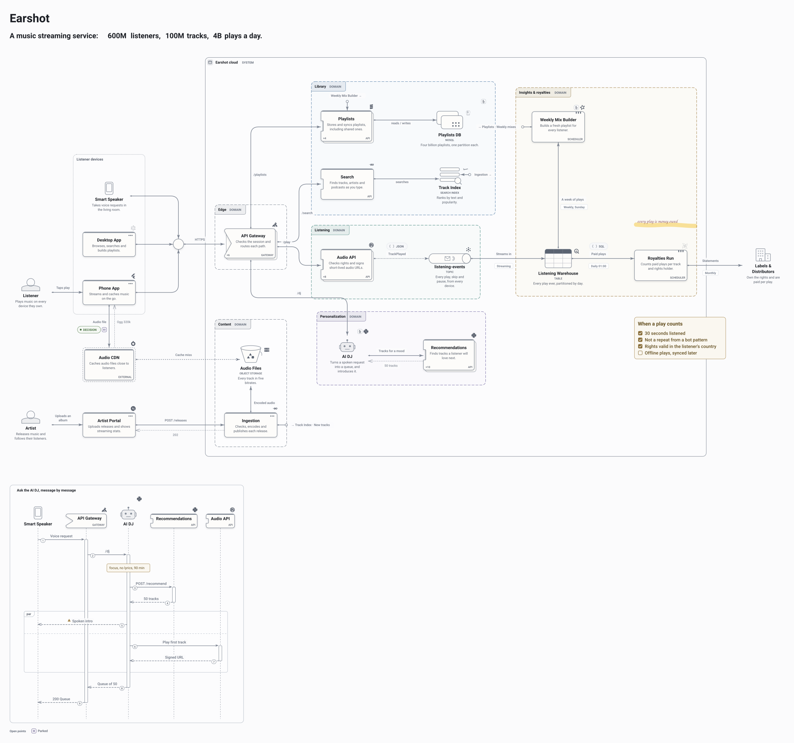

# Music streaming service

A complete, fictional music streaming service, **Earshot**, drawn as one canvas. A tap on a phone
streams a track from a CDN. Thirty seconds later the play counts, and from then on it shapes the
listener's next weekly mix and the money owed to whoever holds the rights. A voice request goes to
an AI DJ, which builds a queue from the recommender and introduces it.

<picture>
  <source media="(prefers-color-scheme: dark)" srcset="preview-dark.svg">
  
</picture>

## The example

- **Listener devices**: a smart speaker, the desktop app (Electron) and the phone app (Flutter)
  meet at a junction before the **API Gateway** (Kong).
- **Library**: **Playlists** (Scala, on ScyllaDB) and **Search** (Go, on Vespa).
- **Listening**: the **Audio API** (Rust) signs short-lived URLs for the **Audio CDN** (Fastly)
  and publishes `TrackPlayed` to `listening-events` (Google Pub/Sub).
- **Personalization**: the **AI DJ** agent asks **Recommendations** for tracks that fit a mood.
- **Insights & royalties**: plays land in a **Listening Warehouse** (BigQuery). The **Weekly Mix
  Builder** (Spark) reads it every Sunday, and the **Royalties Run** (Airflow) every night, before
  statements go out to **Labels & Distributors** each month.
- **Content**: **Artist**s upload through the **Artist Portal** (Next.js). **Ingestion** encodes
  every track into **Audio Files** on Google Cloud Storage.

## Use it when

- Seeing how an AI agent, batch jobs and a live API share one realistic system.
- Explaining how one play becomes a song, a recommendation and a royalty payment.
- Starting a system-design discussion about a consumer platform with a data business.

## Watch out for

- It is a big picture on purpose: present it flow by flow rather than all at once.
- Scale numbers are illustrative; replace them with your own before you reason from them.
- Two connectors are portals and the file is format 29, so it needs a current Draft Canvas.

## Flows

Play these in Draft Canvas with **Present**:

- **Play a song** — tap, signed URL, CDN, and the event that makes it count.
- **First play in a region** (variant) — the CDN misses and fetches from storage.
- **Ask the AI DJ** — a voice request becomes fifty tracks and an introduction.
- **Search and save** — type-ahead search, then a playlist edit that syncs everywhere.
- **Build Monday's mixes** — a week of plays becomes a playlist per listener.
- **Pay the artists** — counted plays, a nightly sum, a monthly statement.
- **Release an album** — upload, encode, and searchable on release day.
- **Recommend, inside the service** and **Release an album** (in **Ingestion**) play inside the
  drill-down views.

## What it shows off

- **An AI agent** as a first-class participant: the AI DJ, its guardrail as a warning note, and a
  native **sequence diagram**, *Ask the AI DJ, message by message*, with a note and a `par` block
  for speaking while the first track loads.
- **Boundaries in boundaries**: six domains inside the system boundary, and a group for devices.
- **A junction** where the speaker, desktop and phone converge on one gateway.
- **Styled text**: a title, a **When a play counts** checklist on an amber card (Markdown task
  list), and a handwritten note with a highlighter stroke under it.
- **Cadence on every pipeline step**: `Streaming`, `Weekly, Sunday`, `Daily 01:00`, `Monthly`.
- **Portals** for the weekly mixes and new-track indexing, which would otherwise cross the system.
- **Depth**: step into **Recommendations** for candidate generation over Milvus, ranking with
  PyTorch and the mix rules. Step into **Ingestion** for the encode pipeline with its dead-letter
  queue.
- **Notes**: the CDN decision, the `TrackPlayed` payload, the royalty SQL, the ScyllaDB decision,
  and a question about private sessions. An open point parks the lossless tier.

Open [music-streaming.draftcanvas](music-streaming.draftcanvas) in Draft Canvas, or add it from
**Starters**.
