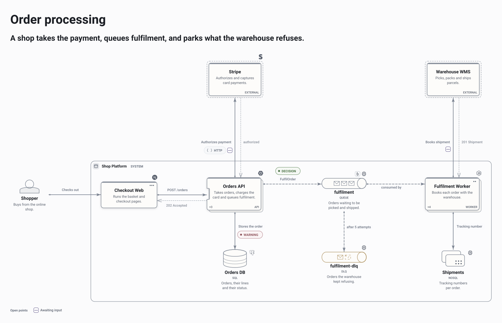

# Order processing

A worked example of a shop's checkout: the Orders API charges the card, stores the order and answers
straight away, while a pool of workers books each shipment with the warehouse. Orders the warehouse
keeps refusing end up in a dead-letter queue instead of being lost.

<picture>
  <source media="(prefers-color-scheme: dark)" srcset="preview-dark.svg">
  
</picture>

## The example

A **Shopper** checks out on **Checkout Web** (Next.js). The **Orders API** (Spring Boot, three
instances) authorizes the card with **Stripe**, stores the order in **Orders DB** (PostgreSQL) and
sends a `FulfilOrder` command to the **fulfilment** queue (SQS). Four **Fulfilment Worker**s compete
for messages, book the shipment with the **Warehouse WMS** and keep the tracking number in
**Shipments** (DynamoDB). After five failed attempts a message moves to **fulfilment-dlq**.

## Use it when

- Learning how shapes, connectors, flows, notes and drill-down views read on the canvas.
- A request must answer fast while slower work, like booking a shipment, happens after.
- Sketching any queue-and-worker design with a failure path.

## Watch out for

- Storing the order and sending the command are two writes; pair it with the Transactional Outbox.
- Competing consumers process orders out of order; nothing here may depend on it.
- A dead-letter queue nobody watches is just a slower way to lose orders.

## Flows

Play these in Draft Canvas with **Present**:

- **Place an order** — from the shopper's click to the tracking number.
- **Warehouse keeps refusing** (failure path, `Shift+F` while presenting) — retries, then the
  dead-letter queue.
- **Place an order, inside the API** — the same request through the API's controller, use case and
  adapters.

## Look closer

- Step into **Orders API** to see its components: the controller, the Place Order use case, and
  the adapters for Stripe, PostgreSQL and SQS.
- Notes explain the decision to answer `202 Accepted`, warn about the dual write, and show the
  Stripe idempotency key and the queued message.
- An open point asks when the payment should be captured.

Open [order-processing.draftcanvas](order-processing.draftcanvas) in Draft Canvas, or add it from
**Starters**.
