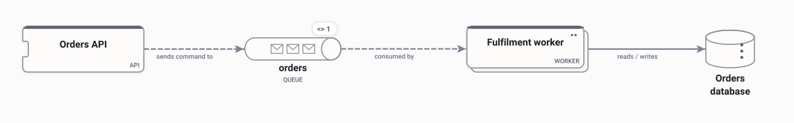

# Order processing

A small worked example: an API queues an order, a worker processes it and records the result.

<picture>
  <source media="(prefers-color-scheme: dark)" srcset="preview-dark.svg">
  
</picture>

## Use it when

- Learning how shapes, connectors and flows read on the canvas.
- A starting point for any queue-and-worker design.

## Watch out for

- It is deliberately small: there is no failure path.

## Flows

Play these in Draft Canvas with **Present**:

- **Place an order**

Open [order-processing.draftcanvas](order-processing.draftcanvas) in Draft Canvas, or add it from **Starters**.
