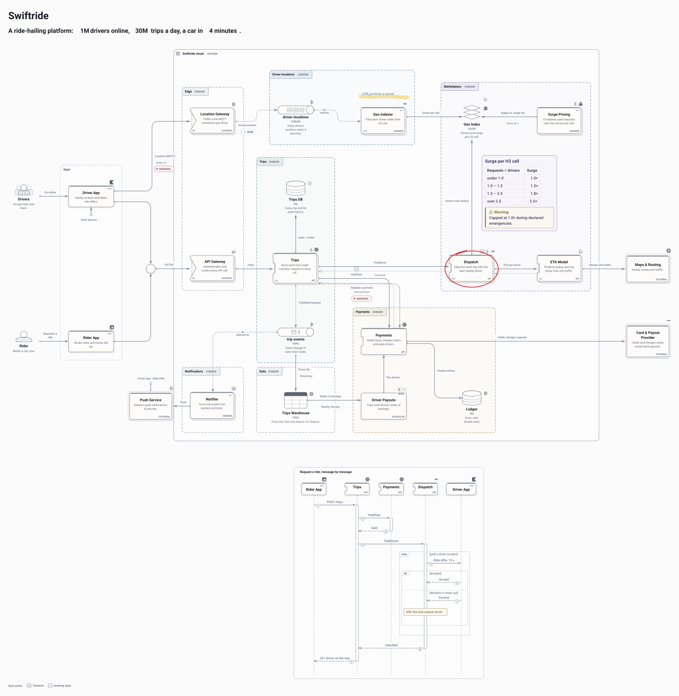

# Ride-hailing platform

A complete, fictional ride-hailing platform, **Swiftride**, drawn as one canvas. Drivers stream
their position every four seconds into a geo index of H3 cells. A rider's request holds the fare on
their card, and Dispatch offers the trip to the nearest drivers one at a time. Surge rises where
requests outnumber drivers. Every trip ends up in a warehouse that pays the drivers each week.

<picture>
  <source media="(prefers-color-scheme: dark)" srcset="preview-dark.svg">
  
</picture>

## The example

- **Apps**: **Drivers** use the **Driver App** (Kotlin), a **Rider** uses the **Rider App**
  (Swift). Both meet at a junction before the **API Gateway** (Envoy).
- **Driver locations**: the Driver App holds an MQTT connection to the **Location Gateway**
  (EMQX), which publishes to `driver-locations` (Kafka). Twelve **Geo Indexer**s file each driver
  under their H3 cell in the **Geo Index** (Redis).
- **Trips**: the **Trips** service (Spring Boot) runs each trip's state machine in **Trips DB**
  (PostgreSQL) and publishes every change to `trip-events`.
- **Marketplace**: **Dispatch** (Go) finds free drivers in the Geo Index and ranks them with the
  **ETA Model** (PyTorch), which uses **Maps & Routing** (Mapbox). **Surge Pricing** (Flink)
  writes a multiplier per cell every minute.
- **Payments**: **Payments** (Spring Boot) holds and charges cards through the **Card & Payout
  Provider** (Adyen) and records every cent in the **Ledger** (CockroachDB). **Driver Payouts**
  (Airflow) pays drivers each Monday.
- **Notifications** and **Data**: the **Notifier** (Node.js) sends ride offers through the **Push
  Service** (Firebase). Every trip lands in the **Trips Warehouse** (Snowflake).

## Use it when

- Seeing a real-time, two-sided system drawn end to end, from a driver's GPS ping to a weekly payout.
- Explaining matching: H3 cells, ETA ranking, one offer at a time, and surge drawing drivers in.
- Starting a system-design discussion about a marketplace with live location and money.

## Watch out for

- It is a big picture on purpose: present it flow by flow rather than all at once.
- Scale numbers and surge multipliers are illustrative; replace them before you reason from them.
- Dispatch is held in place and one connector is a portal, so the file is format 29 and needs a
  current Draft Canvas.

## Flows

Play these in Draft Canvas with **Present**:

- **Request a ride** — from Request to a 15-second offer on the best driver's phone.
- **No driver nearby** (variant) — the search widens from 2 km to 5 km, and surge rises.
- **Rider cancels** (variant) — the card hold is released and the driver is freed.
- **Drivers report location** — MQTT, Kafka, and a new H3 cell every four seconds.
- **Surge recalculates** — supply and demand per cell, every minute.
- **Pay the drivers** — a week of trips becomes ledger entries and bank transfers.
- **Request a ride, inside Trips** and **Match a driver, inside Dispatch** play inside the
  drill-down views.

## What it shows off

- **A held shape**: Dispatch is held in place (the pin), so **Arrange** and **Tidy up** lay the
  rest out around the hub. A hand-drawn red circle marks it on the canvas.
- **A linked compensating action**: **Release card hold** (`ReleaseHold`) undoes `HoldFare` when
  a rider cancels, with a warning on what a missed release costs.
- **Colour with restraint**: four domains carry a colour (Driver locations, Trips, Marketplace,
  Payments). Every shape stays neutral, and the flows bring their own colours.
- **Boundaries in boundaries**: seven domains inside the system boundary, and a group for the apps.
  A **user group** stands for the drivers, and a **junction** merges the two apps' API calls.
- **Styled text**: a title, a **Surge per H3 cell** table with a `[!WARNING]` callout on a violet
  card, and a handwritten "250k positions a second" with a highlighter stroke.
- **A native sequence diagram**, *Request a ride, message by message*, with a `loop` over offers
  and an `alt` for accept or decline, linked to the shapes it describes.
- **A portal** for the push that reaches the Driver App, instead of a line across the whole system.
- **Depth**: step into **Dispatch** for candidate search over H3 rings (with a `k = 2, then 4`
  condition), ETA scoring, the offer sequencer and the acceptance timer. Step into **Trips** for
  the state machine and its transactional outbox.
- **Connector detail**: cadence chips (`Every 4 s`, `Every 60 s`, `Streaming`, `Weekly, Monday`),
  replies (`held`, `matched`), replicas from ×4 to ×12.
- **Notes**: decisions on one-offer-at-a-time dispatch and ledger-first payouts, warnings on lossy
  locations and missed releases, the H3 lookup, the location event, the trip state machine, and a
  question about surge on booked rides. Open points question the 15-second window and wait on
  how tips are charged.

Open [ride-hailing.draftcanvas](ride-hailing.draftcanvas) in Draft Canvas, or add it from
**Starters**.
