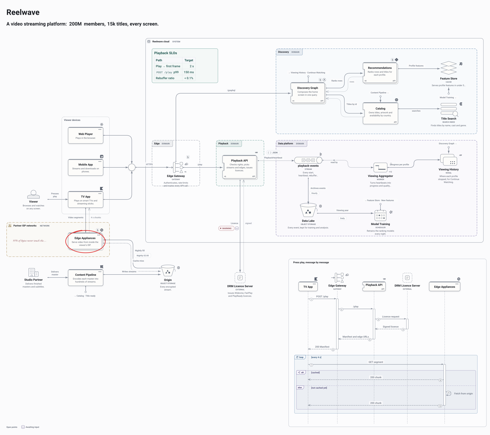

# Video streaming platform

A complete, fictional video streaming service, **Reelwave**, drawn as one canvas. Every screen
talks to the same API edge. The cloud decides what to play, where from, and with which licence.
The video itself comes from appliances inside each viewer's ISP, and every second watched feeds
the data platform that ranks tomorrow's home screen.

<picture>
  <source media="(prefers-color-scheme: dark)" srcset="preview-dark.svg">
  
</picture>

## The example

- **Viewer devices**: TV (Kotlin), mobile (Swift) and web (React) apps meet at a junction before
  the **Edge Gateway** (Envoy, six instances).
- **Discovery**: the **Discovery Graph** (Apollo GraphQL) composes the home screen from
  **Recommendations** (Python, with a Redis feature store) and the **Catalog** (Spring Boot,
  with Elasticsearch).
- **Playback**: the **Playback API** (Go) checks rights, picks streams and edges, and gets a
  licence from the **DRM Licence Server**.
- **Partner ISP networks**: **Edge Appliances** (NGINX) serve the video segments and are filled
  from the **Origin** every night.
- **Data platform**: `playback-events` on Kafka feeds a Flink **Viewing Aggregator** writing
  **Viewing History** (Cassandra), and a **Data Lake** that Spark trains on every night.
- **Content**: a **Studio Partner** delivers masters to the **Content Pipeline**, which encodes
  them with FFmpeg into the Origin.

## Use it when

- Seeing every Draft Canvas feature at work in one realistic system before drawing your own.
- Explaining how video reaches screens: playback decisions in the cloud, bytes from the edge.
- Starting a system-design discussion about a large consumer platform.

## Watch out for

- It is a big picture on purpose: present it flow by flow rather than all at once.
- Scale numbers are illustrative; replace them with your own before you reason from them.
- Three connectors are portals and the file is format 29, so it needs a current Draft Canvas.

## Flows

Play these in Draft Canvas with **Present**:

- **Press play** — from the remote to the first frame, then the heartbeats that save your place.
- **The edge doesn't have it** (variant) — a cache miss falls back to the origin.
- **Open the home screen** — one GraphQL query, forty ranked rows.
- **Launch a new title** — from studio master to searchable title, via the nightly edge fill.
- **Retrain recommendations** — events to the lake to fresh features, with no deploy.
- **Press play, inside the Playback API** and **Encode a new title** play inside the drill-down
  views.

## What it shows off

- **Boundaries in boundaries**: a system boundary holding five domains, a network boundary for the
  ISP-hosted edge, and a plain group for the devices.
- **A junction** where three device apps converge on one gateway.
- **Styled text**: a title, a **Playback SLOs** table on a teal card, and a handwritten callout.
- **Sketch ink**: a hand-drawn circle around the edge appliances.
- **Portals** (`→ Catalog · Title ready`) for the three connectors that would otherwise cross the
  whole system.
- **A native sequence diagram**, *Press play, message by message*, with a `loop` and an `alt`
  for cache hits and misses, linked to the shapes it describes.
- **Depth**: step into **Playback API** for its components (entitlements, stream selection, edge
  steering, licensing). Step into **Content Pipeline** for the chunked encoding pipeline with its
  dead-letter queue.
- **Connector detail**: replies (`200 Manifest`, `4 s chunks`), a fallback line, cadence chips
  (`Nightly 02:00`, `Hourly`, `Daily`), replicas from ×4 to ×12.
- **Notes**: decisions on the ISP edge and on GraphQL, a DRM warning, the heartbeat payload, the
  Envoy route with its retry policy, and an open question about new profiles. An open point
  waits on the offline-licence window.

Open [video-streaming.draftcanvas](video-streaming.draftcanvas) in Draft Canvas, or add it from
**Starters**.
