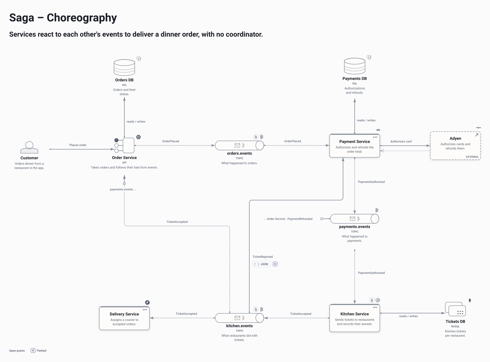

# Saga – Choreography

Services complete a business transaction with no coordinator. Each one reacts to the events it
cares about, commits its own local transaction and publishes what it did. Undoing works the same
way: a failure is just another event, and the services before it react by compensating.

<picture>
  <source media="(prefers-color-scheme: dark)" srcset="preview-dark.svg">
  
</picture>

## The example

A **Customer** orders dinner. The **Order Service** (Spring Boot, PostgreSQL) saves it as pending
and publishes `OrderPlaced` to **orders.events** (Kafka). The **Payment Service** (Go) reacts,
authorizes the card with **Adyen** and publishes `PaymentAuthorized` to **payments.events**. The
**Kitchen Service** (Node.js, MongoDB) reacts by sending the ticket to the restaurant and publishes
the answer to **kitchen.events**, which the Order Service and the **Delivery Service** (FastAPI)
both follow. When the restaurant rejects the ticket, Payment refunds and Order cancels.

## Use it when

- Few steps, owned by different teams, that already communicate through events.
- Avoiding a central workflow service that every change has to go through.
- Each step can decide on its own what to do when it sees a fact.

## Watch out for

- The whole workflow is visible only by following the events; trace a correlation id.
- Nothing times out a stuck saga unless some service is made responsible for it.
- Cyclic dependencies between services creep in as steps grow.
- Compensations are reactions too: a missed event leaves money taken for a cancelled order.

## Flows

Play these in Draft Canvas with **Present**:

- **Order dinner** — from the customer's order to a courier being assigned, one reaction at a time.
- **Restaurant rejects the ticket** (failure path, `Shift+F` while presenting) — `TicketRejected`
  leads to a refund, and `PaymentRefunded` to a cancelled order.

## Look closer

- The two events that travel back to the Order Service are drawn as **portals** (new in Draft
  Canvas's next release): a short labelled stub at each end instead of a line across the whole
  diagram. Click a stub's words to jump to the other end.
- Notes hold the design decision, a `TicketRejected` event, a warning about tracing, and the
  question every choreography has to answer: who cancels an order nobody answers?
- A parked open point sets partial refunds aside.

Open [saga-choreography.draftcanvas](saga-choreography.draftcanvas) in Draft Canvas, or add it from
**Starters**.
