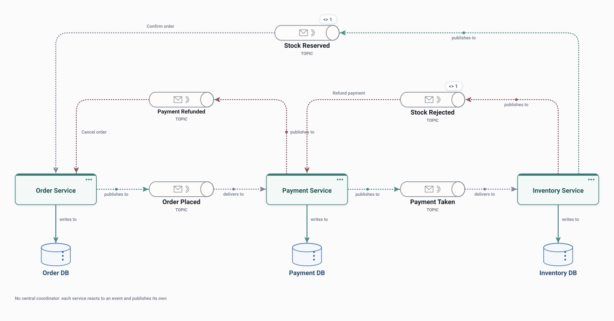

# Saga – Choreography

Services coordinate a business transaction through events with no central coordinator: each reacts to an event and publishes its own outcome, including compensations.

<picture>
  <source media="(prefers-color-scheme: dark)" srcset="preview-dark.svg">
  
</picture>

## Use it when

- Few steps, owned by different teams, that already communicate through events.
- Avoiding a central workflow service.

## Watch out for

- The whole workflow is visible only by following the events.
- Cyclic dependencies between services creep in as steps grow.

## Flows

Play these in Draft Canvas with **Present**:

- **Happy path**
- **Compensation**

Open [saga-choreography.draftcanvas](saga-choreography.draftcanvas) in Draft Canvas, or add it from **Starters**.
