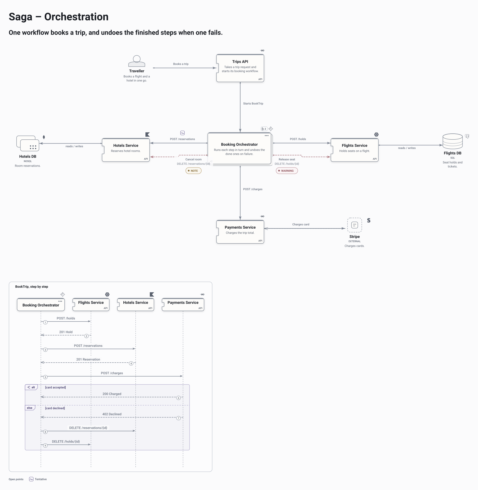

# Saga – Orchestration

One coordinator drives a business transaction that spans several services. Each step commits in its
own service's database; when a later step fails, the coordinator runs the compensations of the
steps already done, newest first.

<picture>
  <source media="(prefers-color-scheme: dark)" srcset="preview-dark.svg">
  
</picture>

## The example

A **Traveller** books a flight and a hotel in one go. The **Trips API** (Go) starts a `BookTrip`
workflow on the **Booking Orchestrator** (Temporal, two workers). It holds a seat with the
**Flights Service** (Spring Boot, PostgreSQL), reserves a room with the **Hotels Service** (Kotlin,
MongoDB) and charges the total through the **Payments Service** and **Stripe**. Each call has a
compensating action drawn beside it: **Release seat** and **Cancel room**.

## Use it when

- A workflow spans several services and must undo completed steps on failure.
- You want one place that knows the workflow's state and can answer "where is my booking?".
- Steps have a fixed order and the riskiest one can go last.

## Watch out for

- The orchestrator can grow into a god service that owns other teams' business rules.
- Every step needs a compensation that really undoes it, and is idempotent when retried.
- A compensation is a new transaction, not a rollback: the seat was held for a while.
- Without durable workflow state, a crash mid-saga leaves steps nobody will undo.

## Flows

Play these in Draft Canvas with **Present**:

- **Book a trip** — hold the seat, reserve the room, charge the card.
- **Card declined** (failure path, `Shift+F` while presenting) — the charge fails and the room, then
  the seat, are compensated.
- **Book a trip, inside the orchestrator** — the same saga as a Temporal workflow and its activities.

## Look closer

- **BookTrip, step by step** is a native sequence diagram beside the architecture: the calls, their
  replies, and the `alt` branch where a declined card turns into compensations.
- Step into **Booking Orchestrator** to see the workflow and one activity per service.
- Notes hold the design decision, a sketch of the workflow code with its compensation stack, a
  warning that compensations must be idempotent, and why cancelling is not a rollback.
- An open point records a working assumption about the hotel's timeout.
- The orchestrator is **held in place** (new in Draft Canvas's next release), so **Arrange** and
  **Tidy up** lay the services out around it rather than moving the hub.

Open [saga-orchestration.draftcanvas](saga-orchestration.draftcanvas) in Draft Canvas, or add it from
**Starters**.
