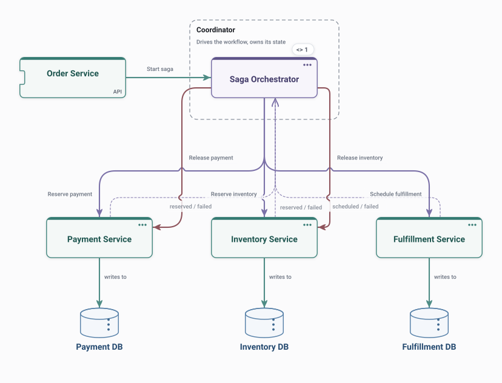

# Saga – Orchestration

A coordinator drives a multi-step business transaction across services, and calls each service's compensation when a later step fails.

<picture>
  <source media="(prefers-color-scheme: dark)" srcset="preview-dark.svg">
  
</picture>

## Use it when

- A workflow spans several services and must undo completed steps on failure.
- You want one place that knows the workflow's state.

## Watch out for

- The orchestrator can become a bottleneck or a god service.
- Every step needs a compensation that really undoes it.

## Flows

Play these in Draft Canvas with **Present**:

- **Happy path**
- **Compensation**

Open [saga-orchestration.draftcanvas](saga-orchestration.draftcanvas) in Draft Canvas, or add it from **Starters**.
