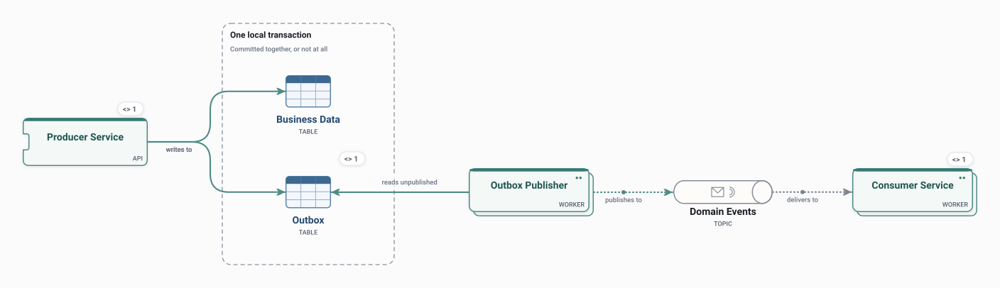

# Transactional Outbox

A service writes its business data and an outbox record in one local transaction; a publisher reads the outbox and publishes the events afterwards.

<picture>
  <source media="(prefers-color-scheme: dark)" srcset="preview-dark.svg">
  
</picture>

## Use it when

- A state change and its event must never disagree.
- Publishing events from a service that owns a database.

## Watch out for

- Events arrive at least once and slightly late.
- The outbox table needs cleaning up.

## Flows

Play these in Draft Canvas with **Present**:

- **Service transaction**
- **Outbox publication**
- **Event consumption**

Open [transactional-outbox.draftcanvas](transactional-outbox.draftcanvas) in Draft Canvas, or add it from **Starters**.
