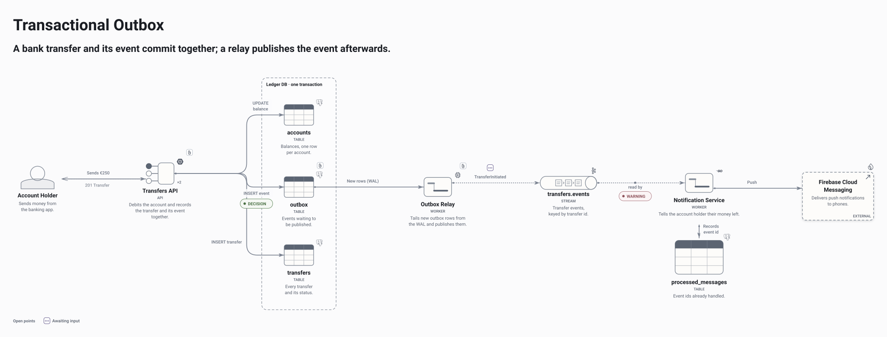

# Transactional Outbox

A service writes its business change and the event announcing it in one local transaction, to its
own database. A relay publishes the event afterwards. The state and the event can never disagree,
and consumers deduplicate because the event may arrive more than once.

<picture>
  <source media="(prefers-color-scheme: dark)" srcset="preview-dark.svg">
  
</picture>

## The example

An **Account Holder** sends €250. The **Transfers API** (Spring Boot, two instances) debits
**accounts**, records the transfer in **transfers** and adds a `TransferInitiated` row to
**outbox**, all in one PostgreSQL transaction in the **Ledger DB**. The **Outbox Relay** (Debezium)
reads committed outbox rows from the write-ahead log and publishes them to **transfers.events**
(Kafka). The **Notification Service** (Go) records each event id in **processed_messages** before it
sends a push through **Firebase Cloud Messaging**, so a redelivered event is skipped.

## Use it when

- A state change and its event must never disagree.
- Publishing events from a service that owns a relational database.
- The broker must not be on the request path: a Kafka outage should not block writes.

## Watch out for

- Events arrive at least once and slightly late; every consumer must deduplicate.
- The outbox table grows unless rows are deleted once published.
- Ordering holds only per message key; choose the key for the order consumers need.
- The relay is one more thing to run and monitor: lag means late events.

## Flows

Play these in Draft Canvas with **Present**:

- **Send money** — one transaction writes three rows; the event is published after the commit.
- **Relay crashes mid-publish** (failure path, `Shift+F` while presenting) — the event arrives
  twice and the consumer's `processed_messages` table drops the duplicate.
- **Send money, inside the API** — the `@Transactional` use case and the two repositories that
  share its connection.

## Look closer

- Step into **Transfers API** to see where the transaction boundary sits in code.
- Notes hold the transaction as SQL, the Debezium outbox event router configuration, the decision
  never to publish inside the transaction, and a warning about at-least-once delivery.
- An open point asks whether events should be keyed by account instead of transfer.

Open [transactional-outbox.draftcanvas](transactional-outbox.draftcanvas) in Draft Canvas, or add it
from **Starters**.
