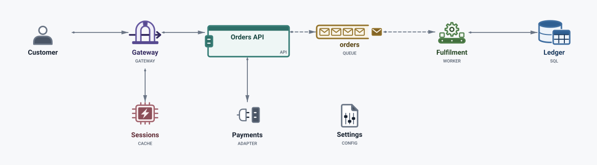
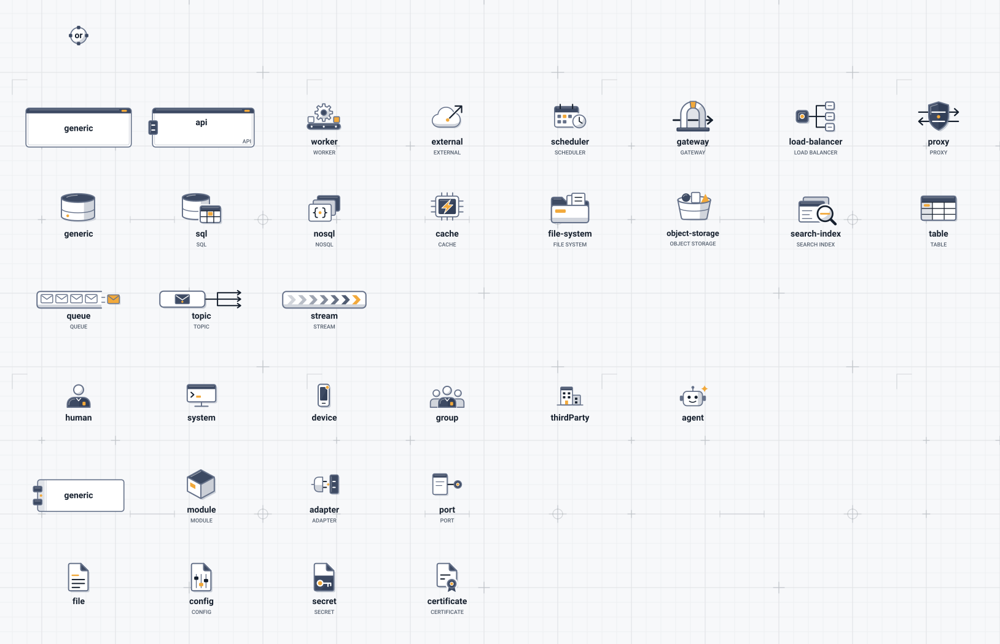

# Professional

Flat and quiet in slate and navy, for documents and slides.

<picture>
  <source media="(prefers-color-scheme: dark)" srcset="preview-dark.svg">
  
</picture>

In Draft Canvas, open **Settings → Appearance → Style packs**, load the gallery and choose **Add**,
or download [professional.draftstyle](professional.draftstyle) and choose **Import style…**. It becomes a style of your
own, to change as you like.

## Every shape

This pack keeps Draft Canvas’s own drawings and changes how they are coloured and finished.

By Draft Canvas, under Apache-2.0. Original artwork.
