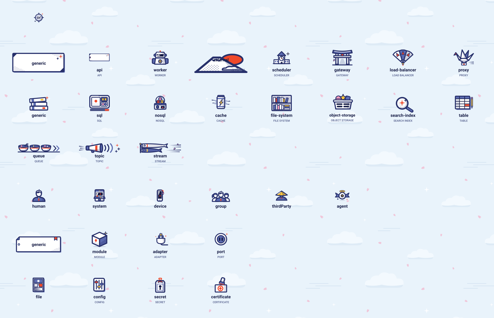

# Weeb

Inked manga under an after-school sky: a shrine gate, a bento box, ramen bowls in line, carp streamers in the wind.

<picture>
  <source media="(prefers-color-scheme: dark)" srcset="preview-dark.svg">
  
</picture>

In Draft Canvas, open **Settings → Appearance → Style packs**, load the gallery and choose **Add**,
or download [weeb.draftstyle](weeb.draftstyle) and choose **Import style…**. It becomes a style of your
own, to change as you like.

## Every shape

Each kind of shape has its own drawing. A shape’s name, its size and where connectors meet it are
exactly as they are without the pack.

By Draft Canvas, under Apache-2.0. Original artwork.
